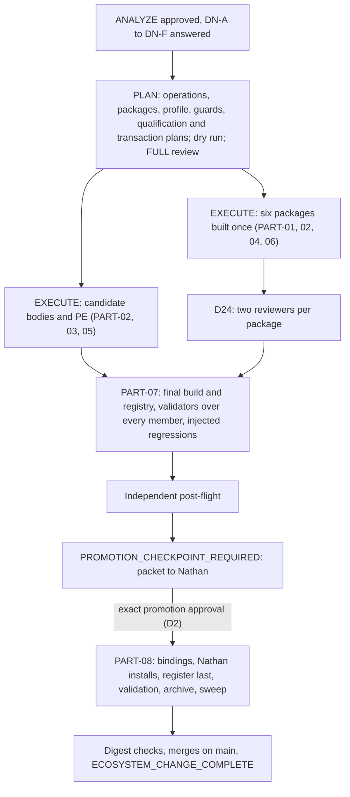

# MODIFICATION-20261011-gcfpe-mb008-to-promotion

**ANALYZE result: MB-008 is larger than its backlog entry, because PF10 addendum 2.1 landed after it was written.** The three named packages still need their F02, F04, F05 and F06 work. F07 is now governed by canon: the TypeSafe reading replaces model and reasoning advice for every GCFPE downstream session, while execution-surface advice stays required. That reaches 53 candidate bodies, PE, the shared handoff contract and five skills, not three. The candidate also still carries the old F05 numbering rule in 14 bodies the parent never checked. Getting to promotion adds a qualification gate and a transaction. Six decisions are Nathan's (§A.7). Nothing has been edited, packaged, installed or selected.

## §A — Analysis

### 1. Request, invocation and record

Nathan, 2026-10-11: “start the MB-008 Modification and take it to promotion.” The run uses the [GCFPE-MGMT-10 three-mode testing body](https://app.notion.com/p/3e34590a05eb811b93d2da9b4ef8106d), `MODE = ANALYZE`, last revised 2026-09-24. That body is approved for testing, not promoted; the selected MGMT-10 is still 091426.1.

[MB-008 on the GCFPE Modification Backlog](https://app.notion.com/p/3e54590a05eb81eb818fd0f42045167a) is S2, `OPEN`, found by `MODIFICATION-20261010-gcfpe-candidate-skill-analysis` when Nathan's DN-1 moved the package side of F02, F04 and F05, together with F06 and F07, out of that record. The parent is `COMPLETE` on `main` (PR #600). No other Modification for MB-008 exists: searched `main`, every remote branch (only `main` exists), every open pull request, and Notion.

This record is new, so `spawned_from` names the parent. **Branch deviation, disclosed:** MGMT-10 names `docs/<yyyymmdd>-modification-<slug>`, but this session's harness requires `claude/mb-008-modification-promotion-fdz2sn` and forbids pushing elsewhere without permission. A fresh session looking only at `docs/*-modification-*` branches will not find this record until it merges; the pull request names it.

### 2. Canon relied on

> Applicable, active, non-superseded PF10 addenda supersede conflicting PF-Canon only for the exact scope they address; otherwise follow PF-Canon. A formally approved bounded Product Owner rescope may supersede conflicting PF-Canon only for the exact decision it adjudicates. *(PF27-Canon-Plan-Templates, Canon precedence for template use)*

| Source, on `main` `9312add2` | Sections read in full | Use |
|---|---|---|
| PF10-HDE-Build-Notes v13.5.2 | complete; one addendum, 2.1 | Governs F07. GCFPE model and reasoning-level guidance is the reading printed by the installed TypeSafe scoring skill. No agent gives its own. "Not read" is reported with a reason. Surface advice is unchanged. It is not a gate. It supersedes PF04 §9.1.3's advice sentence and §9.1.6's "model guidance" for GCFPE. It says its prompt and skill changes are unperformed. |
| PF04-Canon-HDE-Governance v2.8.7 | §9.1.2, §9.1.3, §9.1.5, §9.1.6 | §9.1.2: follow the governing PF position and report the conflict. §9.1.3: storage classes; surface neutrality, which still binds the working model (PF10 2.1 rule 5). §9.1.6: every member change is reconciled with producers, consumers, the catalog, register, map and interacting skills "in one coherent successor selection"; "an edited subgroup is not ready while an affected counterpart remains incompatible"; the Flow Map is updated on repair and activation. |
| PF06-Canon-Change-Process-Guide v2.5.4 | §0.1A | An agent-authored addendum's author resolves the next continuous number at creation (F05, ITEM-04). |
| PF27-Canon-Plan-Templates v2.0.5 | Canon precedence for template use | The precedence rule above; the addendum's numbered-H2 shape. |
| In-flight: the parent | §A, §P (DN-1, PLAN successor 1 §§4–6, successor 2 §§1–3 and 8–10), §E; `findings.md`; `plan-redlines.md`; `source-identities.md` | MB-008's starting point and the parent's listed risks. |
| Repository controls | `AGENTS.md`; decision record D17 and D19–D27; the seven MGMT spine documents; `skill-identity-and-freeze.md`; `skill-packaging-and-delivery.md`; `notion-write-boundary.md`; `prompt-corpus-policy.md`; `prompt-validation-procedure.md`; `postflight-procedure.md`; glow-graph-contract `SKILL.md` | Process applied. |

**Where canon is silent** (each is a decision in §A.7):

- *Where the Product Owner's pick is recorded.* PF10 2.1 rule 2 says "recorded with the reading" and names no place.
- *Who runs the promotion transaction.* PF04 §9.1.6 names no actor; `ecosystem-change-management.md` §6 makes promotion Nathan's; the MGMT-10 body excludes promotion.
- *Whether a post-flight may run as reviewer subagents.* `postflight-procedure.md` says "Fresh session"; D24 covers skill reviews only.

### 3. What moved since MB-008 was written

| Change | Effect on this Modification |
|---|---|
| **PF10 v13.5.2, addendum 2.1, landed 2026-10-11** (after DN-1) | The parent's F07 redline is superseded for model and reasoning: rule 3 forbids an agent's own recommendation of either. Its execution-surface part stands, because PF10 2.1 leaves surface advice unchanged and PF04 §9.1.3 still requires it. F07 becomes "implement the TypeSafe reading, and give surface advice", and rule 1's scope is every downstream-session prompt and handoff, and every management or facilitation relay. |
| Parent `COMPLETE` on `main` | Its candidate graph execution copy (F05, F09) and registry inputs are the starting point MB-008 names. They rebuild at the parent's value: 237 edges, `ff296b1e…`. |
| Installed skills | All 13 digests match their recorded values: 12 in the parent's PLAN successor 1, and glow-po-reporting in D22's status entry. The attribution lock is still the 10-file tree, not the analysed 11-file one (MB-005). |
| TypeSafe uses row for this run | PE40 scored this run on 2026-10-11 under v6 ([row](https://app.notion.com/p/3f64590a05eb813b8af4c3adec853d67)); Nathan's pick is "pending". No agent recommendation is given here (PF10 2.1 rule 3). |

### 4. Per part: closure, tier, class and targets

[closure-candidate.md](evidence/20261011-gcfpe-mb008-to-promotion/closure-candidate.md) pastes all 55 `closure.py` calls over the candidate execution copy; all exit 0. The union is in frontmatter. Skills and PE have no graph part, so their closure is undefined, not empty.

| Part | Class and reason | Targets | Tier and why |
|---|---|---|---|
| PART-01 | B. Applies D27, PF06 §0.1A and PF27 to the packages. F06 is the control-repair half, and DR-1 showed it cannot land apart from the F02 and F05 package values | skill: change-flow, flowmaster-validate, glow-hde-pr-development; probably glow-graph-contract (§A.6, A-3); tool | No prompt part moves, so closure gives no tier. The contract restates all 55 parts, so PART-07's corpus gate covers it |
| PART-02 | B. Applies canon (PF10 2.1 and PF04 §9.1.3). DN-B option 2 needs no new ruling; option 1 needs D28; option 3 needs D28 and a D23 successor for C-PLACE | prompt: 53 candidate bodies and PE; graph: `global.json` if PLAN records the rule there; registry: required and forbidden guards on 53 rows; skill: change-flow, flowmaster-validate, glow-hde-pr-development, session-relay-flowmaster, amthor-workspace-governance-audit; rule: D28 under DN-B option 1 or 3, and a D23 successor under option 3 | **Tier 2.** 53 members change what they produce, which is Tier 1 each regardless of routing. Their radius together is the whole candidate (frontmatter union), and a `global.json` change moves the shared contract |
| PART-03 | B. Completes F05's application (D26-E) | prompt: 14 candidate bodies and PE; registry: a forbidden guard on those rows | Tier 1: text changes, no routing change |
| PART-04 | B. Applies D27 and the native ESC contract | skill: the PART-01 packages | As PART-01 |
| PART-05 | B. Applies D20. D20-B's own wording calls a MGMT-10 rewrite Class A; the ruling exists, so no new D-number is needed | prompt, graph (MGMT-10's part), registry row, notion_control | Tier 1 by MGMT-10's radius: no upstream, downstream PR-10 (§A.6, A-4) |
| PART-06 | C. A stale reference in a control skill | skill: amthor-workspace-governance-audit, `references/epic-reengineering-interoperability.md` | Tier 0 for routing: a non-operative reference |
| PART-07 | C. The release gate | graph, registry, tool; the D24 review of every changed package | **Tier 2.** Corpus-wide by definition |
| PART-08 | B. Applies Nathan's promotion decision | notion_control (register, catalog, Flow Index, hubs, archive), graph (`docs/graph/parts` replaced by the candidate parts), registry, skill installs | **Tier 2.** All 55 parts move relative to the selected graph |

Rule 7 applies: PART-01, PART-02, PART-04 and PART-06 change overlapping packages, so each changed skill ships in one package, one review and one install. PART-07 and PART-08 cannot start until every earlier part lands or is dropped. The Modification's tier is 2.

### 5. Scope, and how it was measured

Details and every line are in [scope-measurement.md](evidence/20261011-gcfpe-mb008-to-promotion/scope-measurement.md). Every number below is broad match minus named exceptions, read in context.

| Surface | Method | Result |
|---|---|---|
| Packages, F02/F04/F05 | regexes over three packages' `*.md`/`*.py`, excluding historical bundled contracts | F02: change-flow `SKILL.md:385`, `:554–555`; flowmaster-validate `SKILL.md:299`, `:358–359`, `validate_flowmaster.py` role checks. F04: change-flow `SKILL.md:379`. F05: change-flow `SKILL.md:323`, glow-hde-pr-development `SKILL.md:147`, flowmaster-validate `validate_gcfpe_20260914.py:1715` |
| Packages, PF10 2.1 | stems `model…Analyzer` over 13 installed skills, minus 7 named exception kinds | 6 conflicting lines in 5 skills: change-flow `:301`; flowmaster-validate `SKILL.md:161`; glow-hde-pr-development `:184`; session-relay-flowmaster `:283`; governance audit `SKILL.md:41` and `interoperability-contracts.md:56`. The bans on routing, gates and an agent's own model or reasoning recommendation stay valid. Surface advice is suppressed by change-flow `:301` ("capability appraisal", "eligibility/suitability") and by flowmaster-validate's forbidden phrase "surface/model/reasoning recommendation" (`validate_flowmaster.py:364`). D23's canonical C-PLACE and C-ART constrain where both go: C-PLACE in change-flow `:299`, glow-hde-pr-development `:174`, session-relay-flowmaster `:285` and the audit's pin `SKILL.md:40`; C-ART in glow-hde-pr-development `:170` and the audit's pin `:39` |
| Bodies, PF10 2.1 | 56 fresh reads ([worker-brief.md](evidence/20261011-gcfpe-mb008-to-promotion/worker-brief.md), [body-scan.json](evidence/20261011-gcfpe-mb008-to-promotion/body-scan.json)) | No page names TypeSafe; no page gives AI advice or surface advice. 53 members and PE carry C-PLACE ("Anything before it is at most a few lines naming what was produced and where; the artifact holds the rest") and C-ART. General prohibitions, which suppress the reading and surface advice alike: PR-10, PR-20, PR-30, PR-35, PR-40, PE. PR-50 emits no handoff, so its two prohibitions match rule 3 and stay. Of the 23 in-block prohibitions, 18 stay as written and the 5 CL ones gain "in the block" |
| Bodies, F05 surviving | same reads | "No agent … allocates PF10 numbering" on 9 members; "The producer never … allocates PF10 numbering" on 5 CL members; PE's *Standards and preservation* sentence. N2 (21) and N3 are exceptions |
| F06 | shipped regenerator on the candidate build, then the shipped 091426.1 validator ([contract-probe.json](evidence/20261011-gcfpe-mb008-to-promotion/contract-probe.json)) | The regenerator works unchanged (633,702 B, `8e1c169e…`). 62 release-bound expectations fail, in 8 classes; the control fails 0 |
| Release and promotion | the register, the 2026-09-21 promotion record and its transaction plan | Three promotion predicates (complete validation of the pinned snapshot; post-flight `PASS` or `PASS WITH WARNINGS` with no mandatory finding; Nathan's approval). Then the register-last transaction: bindings, register, production validation, intact archival, and the sweep by literal (`authoritative-surfaces.md`) |

### 6. Findings, contradictions and risks

| ID | Finding | Defect class |
|---|---|---|
| **A-1** | **F07 is replaced and widened by PF10 2.1, and its surface half stands.** For model and reasoning, the parent's redline is now forbidden: rule 3 bars an agent's own recommendation, and the guidance is the TypeSafe reading instead. Execution-surface advice is unchanged by PF10 2.1, so PF04 §9.1.3 still requires task-specific surface advice for each downstream session. Today no body gives either, and the general prohibitions and five skills forbid both. **Placement must keep D23's canonical texts** (`MODIFICATION-20260923-alpha-feedback-open-entries` §P). D23-B fixes what the block carries. C-PLACE limits the lines before the block to "naming what was produced and where". C-ART puts every result in the output artifact. All three hold if the producing session writes the reading, as the skill prints it, and its surface advice into its output artifact, and the line before the block names them: the reading's cell and flags, and the artifact's path. That needs no new ruling (DN-B options 1 and 2). Printing the full reading before the block exceeds C-PLACE, so it needs a D23 successor (DN-B option 3). Of the 23 in-block prohibitions, 18 stay as written and the 5 CL ones gain "in the block". | FUNC-001, GUARD-001 |
| **A-2** | **F05 survives in 14 bodies and PE.** The parent repaired the six producers. These others still say no agent, or no producer, numbers an addendum, contrary to PF06 §0.1A and to the repaired producers. The parent's guard checked only seven rows and PE (its listed risk P2-6). The six packages' F05 text is in PART-01. | SCOPE-001, GUARD-001 |
| **A-3** | **F06 is measurable now.** The shipped recipe regenerates a candidate contract without code change. A 100926.1 profile must replace 62 release-bound validator expectations (member bindings, the PF10 contract assertion, the routing surface, selection evidence, graph identity and profile). The regenerator's contract-only value table, and the validator's matching `EXPECTED_RECEIVERS`, still describe 091426.1: PR-20's accepted inputs lack F09's RS-20 pre-Proceed return. glow-graph-contract therefore probably changes too. PLAN confirms or rules it out. | PAIR-001, DERIV-001 |
| **A-4** | **The reused GCFPE-MGMT-10 091426.1 does not fit the candidate.** It is the six-input Batch method D20 found had "lost its method" (parent L01). It has two handoff branches with no reading and no D23-B handoff contract. Its conditional handoff names `PR-10 — 091426.1`, a page promotion would archive. | STALE-001 |
| **A-5** | **Promotion needs the installs and the selection together.** Repaired skills installed before selection contradict the selected bodies (parent DR-2, PF04 §9.1.6). Bodies promoted without the skills contradict the skills. Both land in one transaction. | — |
| **A-6** | **The selected release conflicts with PF10 2.1 today.** 091426.1's bodies and skills forbid evaluating a runtime setting, and PF10 2.1 is in force. PF04 §9.1.2 says follow the PF position and report the conflict. This Modification does not edit the selected release (`ecosystem-change-management.md` §6: touching it is Nathan's). The conflict ends at promotion. | SCOPE-002 |
| A-7 | typesafe-scoring needs no change established for this. Its description reads "Glow app session prompt" and it records a Notion row; its trigger includes "the TypeSafe reading". Its fit to a GCFPE handoff (the action text, the `--session` value) is a PLAN detail. Its Notion row is DN-B. | — |
| A-8 | The PF10 2.1 rule depends on the skill and its credential being present. Where either is missing, rule 4's "not read, with the reason" applies, loudly. | listed |
| A-9 | **Outside MB-008:** "Each handoff carries the complete native input package, …" in PR-10, PR-20, PR-30 and PR-40 contradicts D23-B. Proposed as backlog MB-010, S3. It sits in the same section as a PART-02 edit, so batching it costs little if Nathan opts in (DN-A). | recorded |
| A-10 | Listed and unchanged: MB-005 (DN-E), MB-006, MB-007 outside GCFPE, MB-009, the parent's L02–L11, and the CL family's uneven "runtime configuration guidance" wording, which forbids and gives nothing. | listed |

### 7. Open questions for the Product Owner

Each is a round trip. One reply can answer all six.

**DN-A — scope opt-ins.**
1. Include F01 and F08 (PART-04)? **Recommended: yes.** They are loud incompatibilities between these same packages and the candidate. PF04 §9.1.6 does not let an edited subgroup ship while a counterpart is incompatible. They ride the same packages and review.
2. Batch MB-010's D23-B sentence into PART-02's edits on PR-10/20/30/40? **Recommended: no.** It is another rule, outside MB-008, and is better recorded on the backlog. Choosing yes adds one operation per page.

**DN-B — how the TypeSafe reading reaches you, and where your pick is recorded** (PF10 2.1 rule 2: reported "as the skill prints it", and "the pick is recorded with the reading"). In every option the session runs the skill's script with one action text. It never puts the reading inside the handoff block, replacing the skill's step 3 (paste into the prompt header). It gives no recommendation of its own.
- **Option 1, recommended:** the producing session writes the printed reading into its output artifact (C-ART). The line before the block names the cell, the flags and the artifact path (C-PLACE). It also creates the reading's row in the TypeSafe uses table, and corrects that row only after a failed readback (the skill's step 4). You set *Nathan's pick* on the row yourself, or tell any session your pick and it sets that one field. That needs a destination rule, **D28**, recorded before EXECUTE, authorizing exactly those three writes in that one data source and no other (`notion-write-boundary.md`). It would be the first broad Notion write by flow sessions since the 2026-09-22 policy. D23-B, C-PLACE and C-ART stay as written. You get one central log with your picks beside the readings.
- Option 2: as option 1, without the Notion row. Your pick is recorded by the receiving session in its own output artifact when you state it. No new rule, and no flow-session Notion writes, but the readings are spread across artifacts.
- Option 3: as option 1, but the full printed reading is shown on the lines before the block. That exceeds C-PLACE, so it needs a D23 successor amending C-PLACE in the 53 bodies, PE, change-flow `:299`, glow-hde-pr-development `:174`, session-relay-flowmaster `:285` and the audit's pin `SKILL.md:40`, plus D28. Two rulings, and more edits.

**DN-C — GCFPE-MGMT-10 in the release.**
- **A, recommended:** the D20 three-mode body becomes MGMT-10's successor, with one line giving the reading when a later mode may start in a fresh session. It is the body actually in use, it hands off to no prompt, and it removes the stale PR-10 binding (A-4). Cost: a successor page, its graph part and registry row, and their place in qualification.
- B: a 100926.1 sibling of the six-input body, adding only the reading and the PR-10 binding fix. It keeps the D20 debt.
- C: reuse 091426.1 unchanged and accept A-4 as a listed risk. The release then ships a member that conflicts with PF10 2.1 on two rare branches.

**DN-D — the promotion boundary.**
- **D2, recommended:** after qualification, EXECUTE returns `PROMOTION_CHECKPOINT_REQUIRED` with the packet. Your exact promotion approval then authorizes this Modification to run the transaction (PART-08), including the install hand-off and digest checks. It waives, for this run, MGMT-10's line that it does not execute promotion. The installs are tied to the selection (A-5), and the plan is built here.
- D1: this Modification stops at `PROMOTION_CHECKPOINT_REQUIRED`, and a separate release-transaction run does the rest. That adds about four round trips, and the installs wait for it.

**DN-E — the attribution-lock validation sibling (MB-005).** **E1, recommended:** qualify with the installed 10-file tree (`c518ccb0…`), bound by digest. It passes the suite and profile, and it is what sessions load. MB-005 stays open. E2: supply the analysed 11-file archive (`ee253cfa…`).

**DN-F — the post-flight's independence.** **F1, recommended:** two fresh-context reviewer subagents under D24's conditions: brief committed first, primary evidence, own records, never the author or a §10 reviewer. F2: a separate session you start, as `postflight-procedure.md` reads literally. It adds one round trip.

### 8. Readiness and interaction cost

**Readiness: `NEEDS_RULING`**, advisory. Neither split predicate holds:
- *No sequential discovery.* Every item's scope is measured above. PLAN fixes exact anchors and digests in its dry run.
- *No unmeasured scope.* A-3's glow-graph-contract change is bounded by the value-table entries named there.

    interaction_cost = open rulings 6 + 2 + ANALYZE and PLAN review rounds 2 + skill review cycles 1
                       + installs 6 + merges 2 = 19

- **Installs:** change-flow, flowmaster-validate, glow-hde-pr-development, session-relay-flowmaster, amthor-workspace-governance-audit, and probably glow-graph-contract.
- **Merges:** this record's pull request, and the promotion pull request that replaces `docs/graph/parts` and the registry.
- **Outside the formula:** your promotion approval.
- **Range:** a second FULL review in each mode and a repeated skill cycle make it 22. Answering the six rulings in one message makes the actual lower.

**What a split would save:**
- **Moving PART-02 to its own run:** adds two approvals, at least two review rounds and a merge. It shares all five packages (`shares_package_with`), so no install is saved, and promotion still waits for it. Net about +5.
- **D1 instead of D2:** net about +4.
- **Dropping PART-04 or choosing DN-C option C:** saves no round trip.

No split is recommended. No other open Modification changes these skills.

**Estimate** (frontmatter `estimate`): PLAN 6–10 h and 4–7M aggregate tokens; EXECUTE 12–20 h and 6–10M, excluding waiting. These are forecasts; twice them triggers a re-price (D26-D). The parent's PLAN of eight pages measured about 3M tokens.

### 9. Checks, limits and transient reads

- **Checks run:** 55 closure calls; both graph builds; the contract probe with its control; 13 skill digests; 56 page reads; 8 quotes re-verified; the record validator.
- **Not run:** no package was edited, packaged or reviewed. No prompt was edited. No TypeSafe call was made. No validator ran over prompt bodies.
- **Worker model:** inherited; no model was set for any worker.
- **D22:** the workers' harness-saved reads of OPS-10, OPS-30, QA-10, PE, PR-10, PR-20 and PR-40 are seven tool-results files, listed in `body-scan.json` (`worker_notes`). They were used only for that scan, are not reopened, and are left to the harness's teardown. The coordinator's reads of PR-30, PR-35 and CL-40 were inline. The register fetch the harness saved is not a prompt body.
- **Retention:** `body-scan.json` keeps per-page counts and each distinct sentence once, the minimum evidence `prompt-corpus-policy.md` allows.

### 10. Review

ANALYZE review under D26-A follows the dry run in the ledger.

**Round 1, 2026-10-11.** Two fresh-context reviewers reviewed commit `978d233e` from briefs committed at `5fbfeede` before they were spawned: [reviewer A](evidence/20261011-gcfpe-mb008-to-promotion/REVIEW-ANALYZE-1-A.md) and [reviewer B](evidence/20261011-gcfpe-mb008-to-promotion/REVIEW-ANALYZE-1-B.md). Both reproduced every measurement: the closure union, both builds, the candidate contract, the probe, the 13 digests and the validator. They also re-read 19 pages fresh (A 8, B 11), and every one matched `body-scan.json`. They found three distinct required defects, all in the analysis's handling of PF10 2.1:

| ID | Finding | Repair |
|---|---|---|
| R-A1 (R3) | Printing the reading beside the block breaks D23's C-PLACE or C-ART, and no D23 successor was targeted | A-1 names D23-B, C-PLACE and C-ART. The reading and surface advice go into the artifact; the line before the block names them. DN-B option 3 carries the D23 successor. `scope-measurement.md` §2a-bis lists every place the texts are restated |
| B-1 (R1) | The execution-surface half of F07 was dropped, although PF10 2.1 leaves it and PF04 §9.1.3 requires it | §A.3, A-1, ITEM-03, PART-02 and §A.5 separate surface advice from the reading. The surface-advice suppressors are dispositioned in `scope-measurement.md` §2a |
| B-2 (R3) | DN-B option B2 ran the skill "as built", which writes beyond its own D28 and puts the reading in the block | DN-B states each option's exact writes and placement. D28 covers create, correct after a failed readback, and set Nathan's pick on his statement |

The 33 LISTED findings (A: L-A1 to L-A15; B: L-B1 to L-B18) stay listed. They go to Nathan as accepted risks unless he opts into one. One bounded DIFF_CHECK of the repair follows. It is the last review this mode allows under D26-A.
