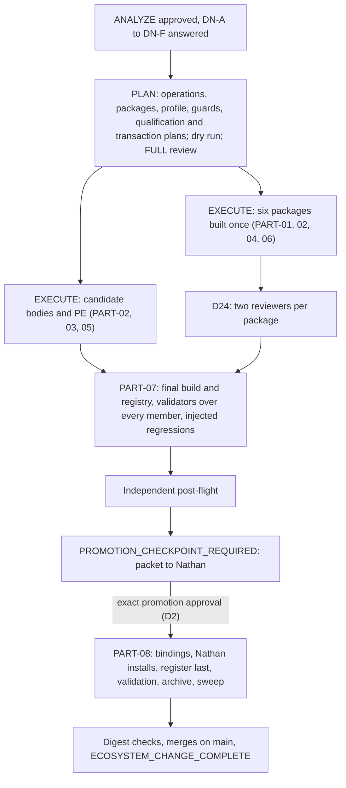

# MODIFICATION-20261011-gcfpe-mb008-to-promotion

**ANALYZE result: MB-008 is larger than its backlog entry, because PF10 addendum 2.1 landed after it was written.** The three named packages still need their F02, F04, F05 and F06 work. F07 is now governed by canon: the TypeSafe reading replaces model and reasoning advice for every GCFPE downstream session, while execution-surface advice stays required. That reaches 53 candidate bodies, PE, the shared handoff contract and five skills, not three. The candidate also still carries the old F05 numbering rule in 14 bodies the parent never checked. Getting to promotion adds a qualification gate and a transaction. Six decisions are Nathan's (§A.7). Nothing has been edited, packaged, installed or selected.

## §A — Analysis

### 1. Request, invocation and record

Nathan, 2026-10-11: “start the MB-008 Modification and take it to promotion.” The run uses the [GCFPE-MGMT-10 three-mode testing body](https://app.notion.com/p/3e34590a05eb811b93d2da9b4ef8106d), `MODE = ANALYZE`, last revised 2026-09-24. That body is approved for testing, not promoted; the selected MGMT-10 is still 091426.1.

[MB-008 on the GCFPE Modification Backlog](https://app.notion.com/p/3e54590a05eb81eb818fd0f42045167a) is S2, `OPEN`, found by `MODIFICATION-20261010-gcfpe-candidate-skill-analysis` when Nathan's DN-1 moved the package side of F02, F04 and F05, together with F06 and F07, out of that record. The parent is `COMPLETE` on `main` (PR #600). No other Modification for MB-008 exists: searched `main`, every remote branch (only `main` exists), every open pull request, and Notion.

This record is new, so `spawned_from` names the parent. **Branch deviation, disclosed:** MGMT-10 names `docs/<yyyymmdd>-modification-<slug>`, but this session's harness requires `claude/mb-008-modification-promotion-fdz2sn` and forbids pushing elsewhere without permission. A fresh session looking only at `docs/*-modification-*` branches will not find this record until it merges; the pull request names it.

### 2. Canon relied on

> Applicable, active, non-superseded PF10 addenda supersede conflicting PF-Canon only for the exact scope they address; otherwise follow PF-Canon. A formally approved bounded Product Owner rescope may supersede conflicting PF-Canon only for the exact decision it adjudicates. *(PF27-Canon-Plan-Templates, Canon precedence for template use)*

| Source, on `main` `9312add2` | Sections read in full | Use |
|---|---|---|
| PF10-HDE-Build-Notes v13.5.2 | complete; one addendum, 2.1 | Governs F07. GCFPE model and reasoning-level guidance is the reading printed by the installed TypeSafe scoring skill. No agent gives its own. "Not read" is reported with a reason. Surface advice is unchanged. It is not a gate. It supersedes PF04 §9.1.3's advice sentence and §9.1.6's "model guidance" for GCFPE. It says its prompt and skill changes are unperformed. |
| PF04-Canon-HDE-Governance v2.8.7 | §9.1.2, §9.1.3, §9.1.5, §9.1.6 | §9.1.2: follow the governing PF position and report the conflict. §9.1.3: storage classes; surface neutrality, which still binds the working model (PF10 2.1 rule 5). §9.1.6: every member change is reconciled with producers, consumers, the catalog, register, map and interacting skills "in one coherent successor selection"; "an edited subgroup is not ready while an affected counterpart remains incompatible"; the Flow Map is updated on repair and activation. |
| PF06-Canon-Change-Process-Guide v2.5.4 | §0.1A | An agent-authored addendum's author resolves the next continuous number at creation (F05, ITEM-04). |
| PF27-Canon-Plan-Templates v2.0.5 | Canon precedence for template use | The precedence rule above; the addendum's numbered-H2 shape. |
| In-flight: the parent | §A, §P (DN-1, PLAN successor 1 §§4–6, successor 2 §§1–3 and 8–10), §E; `findings.md`; `plan-redlines.md`; `source-identities.md` | MB-008's starting point and the parent's listed risks. |
| Repository controls | `AGENTS.md`; decision record D17 and D19–D27; the seven MGMT spine documents; `skill-identity-and-freeze.md`; `skill-packaging-and-delivery.md`; `notion-write-boundary.md`; `prompt-corpus-policy.md`; `prompt-validation-procedure.md`; `postflight-procedure.md`; glow-graph-contract `SKILL.md` | Process applied. |

**Where canon is silent** (each is a decision in §A.7):

- *Where the Product Owner's pick is recorded.* PF10 2.1 rule 2 says "recorded with the reading" and names no place.
- *Who runs the promotion transaction.* PF04 §9.1.6 names no actor; `ecosystem-change-management.md` §6 makes promotion Nathan's; the MGMT-10 body excludes promotion.
- *Whether a post-flight may run as reviewer subagents.* `postflight-procedure.md` says "Fresh session"; D24 covers skill reviews only.

### 3. What moved since MB-008 was written

| Change | Effect on this Modification |
|---|---|
| **PF10 v13.5.2, addendum 2.1, landed 2026-10-11** (after DN-1) | The parent's F07 redline is superseded for model and reasoning: rule 3 forbids an agent's own recommendation of either. Its execution-surface part stands, because PF10 2.1 leaves surface advice unchanged and PF04 §9.1.3 still requires it. F07 becomes "implement the TypeSafe reading, and give surface advice", and rule 1's scope is every downstream-session prompt and handoff, and every management or facilitation relay. |
| Parent `COMPLETE` on `main` | Its candidate graph execution copy (F05, F09) and registry inputs are the starting point MB-008 names. They rebuild at the parent's value: 237 edges, `ff296b1e…`. |
| Installed skills | All 13 digests match their recorded values: 12 in the parent's PLAN successor 1, and glow-po-reporting in D22's status entry. The attribution lock is still the 10-file tree, not the analysed 11-file one (MB-005). |
| TypeSafe uses row for this run | PE40 scored this run on 2026-10-11 under v6 ([row](https://app.notion.com/p/3f64590a05eb813b8af4c3adec853d67)); Nathan's pick is "pending". No agent recommendation is given here (PF10 2.1 rule 3). |

### 4. Per part: closure, tier, class and targets

[closure-candidate.md](evidence/20261011-gcfpe-mb008-to-promotion/closure-candidate.md) pastes all 55 `closure.py` calls over the candidate execution copy; all exit 0. The union is in frontmatter. Skills and PE have no graph part, so their closure is undefined, not empty.

| Part | Class and reason | Targets | Tier and why |
|---|---|---|---|
| PART-01 | B. Applies D27, PF06 §0.1A and PF27 to the packages. F06 is the control-repair half, and DR-1 showed it cannot land apart from the F02 and F05 package values | skill: change-flow, flowmaster-validate, glow-hde-pr-development; probably glow-graph-contract (§A.6, A-3); tool | No prompt part moves, so closure gives no tier. The contract restates all 55 parts, so PART-07's corpus gate covers it |
| PART-02 | B. Applies canon (PF10 2.1 and PF04 §9.1.3). DN-B option 2 needs no new ruling; option 1 needs D28; option 3 needs D28 and a D23 successor for C-PLACE | prompt: 53 candidate bodies and PE; graph: `global.json` if PLAN records the rule there; registry: required and forbidden guards on 53 rows; skill: change-flow, flowmaster-validate, glow-hde-pr-development, session-relay-flowmaster, amthor-workspace-governance-audit; rule: D28 under DN-B option 1 or 3, and a D23 successor under option 3 | **Tier 2.** 53 members change what they produce, which is Tier 1 each regardless of routing. Their radius together is the whole candidate (frontmatter union), and a `global.json` change moves the shared contract |
| PART-03 | B. Completes F05's application (D26-E) | prompt: 14 candidate bodies and PE; registry: a forbidden guard on those rows | Tier 1: text changes, no routing change |
| PART-04 | B. Applies D27 and the native ESC contract | skill: the PART-01 packages | As PART-01 |
| PART-05 | B. Applies D20. D20-B's own wording calls a MGMT-10 rewrite Class A; the ruling exists, so no new D-number is needed | prompt, graph (MGMT-10's part), registry row, notion_control | Tier 1 by MGMT-10's radius: no upstream, downstream PR-10 (§A.6, A-4) |
| PART-06 | C. A stale reference in a control skill | skill: amthor-workspace-governance-audit, `references/epic-reengineering-interoperability.md` | Tier 0 for routing: a non-operative reference |
| PART-07 | C. The release gate | graph, registry, tool; the D24 review of every changed package | **Tier 2.** Corpus-wide by definition |
| PART-08 | B. Applies Nathan's promotion decision | notion_control (register, catalog, Flow Index, hubs, archive), graph (`docs/graph/parts` replaced by the candidate parts), registry, skill installs | **Tier 2.** All 55 parts move relative to the selected graph |

Rule 7 applies: PART-01, PART-02, PART-04 and PART-06 change overlapping packages, so each changed skill ships in one package, one review and one install. PART-07 and PART-08 cannot start until every earlier part lands or is dropped. The Modification's tier is 2.

### 5. Scope, and how it was measured

Details and every line are in [scope-measurement.md](evidence/20261011-gcfpe-mb008-to-promotion/scope-measurement.md). Every number below is broad match minus named exceptions, read in context.

| Surface | Method | Result |
|---|---|---|
| Packages, F02/F04/F05 | regexes over three packages' `*.md`/`*.py`, excluding historical bundled contracts | F02: change-flow `SKILL.md:385`, `:554–555`; flowmaster-validate `SKILL.md:299`, `:358–359`, `validate_flowmaster.py` role checks. F04: change-flow `SKILL.md:379`. F05: change-flow `SKILL.md:323`, glow-hde-pr-development `SKILL.md:147`, flowmaster-validate `validate_gcfpe_20260914.py:1715` |
| Packages, PF10 2.1 | stems `model…Analyzer` over 13 installed skills, minus 7 named exception kinds | 6 conflicting lines in 5 skills: change-flow `:301`; flowmaster-validate `SKILL.md:161`; glow-hde-pr-development `:184`; session-relay-flowmaster `:283`; governance audit `SKILL.md:41` and `interoperability-contracts.md:56`. The bans on routing, gates and an agent's own model or reasoning recommendation stay valid. Surface advice is suppressed by change-flow `:301` ("capability appraisal", "eligibility/suitability") and by flowmaster-validate's forbidden phrase "surface/model/reasoning recommendation" (`validate_flowmaster.py:364`). D23's canonical C-PLACE and C-ART constrain where both go: C-PLACE in change-flow `:299`, glow-hde-pr-development `:174`, session-relay-flowmaster `:285` and the audit's pin `SKILL.md:40`; C-ART in glow-hde-pr-development `:170` and the audit's pin `:39` |
| Bodies, PF10 2.1 | 56 fresh reads ([worker-brief.md](evidence/20261011-gcfpe-mb008-to-promotion/worker-brief.md), [body-scan.json](evidence/20261011-gcfpe-mb008-to-promotion/body-scan.json)) | No page names TypeSafe; no page gives AI advice or surface advice. 53 members and PE carry C-PLACE ("Anything before it is at most a few lines naming what was produced and where; the artifact holds the rest") and C-ART. General prohibitions, which suppress the reading and surface advice alike: PR-10, PR-20, PR-30, PR-35, PR-40, PE. PR-50 emits no handoff, so its two prohibitions match rule 3 and stay. Of the 23 in-block prohibitions, 18 stay as written and the 5 CL ones gain "in the block" |
| Bodies, F05 surviving | same reads | "No agent … allocates PF10 numbering" on 9 members; "The producer never … allocates PF10 numbering" on 5 CL members; PE's *Standards and preservation* sentence. N2 (21) and N3 are exceptions |
| F06 | shipped regenerator on the candidate build, then the shipped 091426.1 validator ([contract-probe.json](evidence/20261011-gcfpe-mb008-to-promotion/contract-probe.json)) | The regenerator works unchanged (633,702 B, `8e1c169e…`). 62 release-bound expectations fail, in 8 classes; the control fails 0 |
| Release and promotion | the register, the 2026-09-21 promotion record and its transaction plan | Three promotion predicates (complete validation of the pinned snapshot; post-flight `PASS` or `PASS WITH WARNINGS` with no mandatory finding; Nathan's approval). Then the register-last transaction: bindings, register, production validation, intact archival, and the sweep by literal (`authoritative-surfaces.md`) |

### 6. Findings, contradictions and risks

| ID | Finding | Defect class |
|---|---|---|
| **A-1** | **F07 is replaced and widened by PF10 2.1, and its surface half stands.** For model and reasoning, the parent's redline is now forbidden: rule 3 bars an agent's own recommendation, and the guidance is the TypeSafe reading instead. Execution-surface advice is unchanged by PF10 2.1, so PF04 §9.1.3 still requires task-specific surface advice for each downstream session. Today no body gives either, and the general prohibitions and five skills forbid both. **Placement must keep D23's canonical texts** (`MODIFICATION-20260923-alpha-feedback-open-entries` §P). D23-B fixes what the block carries. C-PLACE limits the lines before the block to "naming what was produced and where". C-ART puts every result in the output artifact. All three hold if the producing session writes the reading, as the skill prints it, and its surface advice into its output artifact, and the line before the block names them: the reading's cell and flags, and the artifact's path. That needs no new ruling (DN-B options 1 and 2). Printing the full reading before the block exceeds C-PLACE, so it needs a D23 successor (DN-B option 3). Of the 23 in-block prohibitions, 18 stay as written and the 5 CL ones gain "in the block". | FUNC-001, GUARD-001 |
| **A-2** | **F05 survives in 14 bodies and PE.** The parent repaired the six producers. These others still say no agent, or no producer, numbers an addendum, contrary to PF06 §0.1A and to the repaired producers. The parent's guard checked only seven rows and PE (its listed risk P2-6). The six packages' F05 text is in PART-01. | SCOPE-001, GUARD-001 |
| **A-3** | **F06 is measurable now.** The shipped recipe regenerates a candidate contract without code change. A 100926.1 profile must replace 62 release-bound validator expectations (member bindings, the PF10 contract assertion, the routing surface, selection evidence, graph identity and profile). The regenerator's contract-only value table, and the validator's matching `EXPECTED_RECEIVERS`, still describe 091426.1: PR-20's accepted inputs lack F09's RS-20 pre-Proceed return. glow-graph-contract therefore probably changes too. PLAN confirms or rules it out. | PAIR-001, DERIV-001 |
| **A-4** | **The reused GCFPE-MGMT-10 091426.1 does not fit the candidate.** It is the six-input Batch method D20 found had "lost its method" (parent L01). It has two handoff branches with no reading and no D23-B handoff contract. Its conditional handoff names `PR-10 — 091426.1`, a page promotion would archive. | STALE-001 |
| **A-5** | **Promotion needs the installs and the selection together.** Repaired skills installed before selection contradict the selected bodies (parent DR-2, PF04 §9.1.6). Bodies promoted without the skills contradict the skills. Both land in one transaction. | — |
| **A-6** | **The selected release conflicts with PF10 2.1 today.** 091426.1's bodies and skills forbid evaluating a runtime setting, and PF10 2.1 is in force. PF04 §9.1.2 says follow the PF position and report the conflict. This Modification does not edit the selected release (`ecosystem-change-management.md` §6: touching it is Nathan's). The conflict ends at promotion. | SCOPE-002 |
| A-7 | typesafe-scoring needs no change established for this. Its description reads "Glow app session prompt" and it records a Notion row; its trigger includes "the TypeSafe reading". Its fit to a GCFPE handoff (the action text, the `--session` value) is a PLAN detail. Its Notion row is DN-B. | — |
| A-8 | The PF10 2.1 rule depends on the skill and its credential being present. Where either is missing, rule 4's "not read, with the reason" applies, loudly. | listed |
| A-9 | **Outside MB-008:** "Each handoff carries the complete native input package, …" in PR-10, PR-20, PR-30 and PR-40 contradicts D23-B. Proposed as backlog MB-010, S3. It sits in the same section as a PART-02 edit, so batching it costs little if Nathan opts in (DN-A). | recorded |
| A-10 | Listed and unchanged: MB-005 (DN-E), MB-006, MB-007 outside GCFPE, MB-009, the parent's L02–L11, and the CL family's uneven "runtime configuration guidance" wording, which forbids and gives nothing. | listed |

### 7. Open questions for the Product Owner

Each is a round trip. One reply can answer all six.

**DN-A — scope opt-ins.**
1. Include F01 and F08 (PART-04)? **Recommended: yes.** They are loud incompatibilities between these same packages and the candidate. PF04 §9.1.6 does not let an edited subgroup ship while a counterpart is incompatible. They ride the same packages and review.
2. Batch MB-010's D23-B sentence into PART-02's edits on PR-10/20/30/40? **Recommended: no.** It is another rule, outside MB-008, and is better recorded on the backlog. Choosing yes adds one operation per page.

**DN-B — how the TypeSafe reading reaches you, and where your pick is recorded** (PF10 2.1 rule 2: reported "as the skill prints it", and "the pick is recorded with the reading"). In every option the session runs the skill's script with one action text. It never puts the reading inside the handoff block, replacing the skill's step 3 (paste into the prompt header). It gives no recommendation of its own.
- **Option 1, recommended:** the producing session writes the printed reading into its output artifact (C-ART). The line before the block names the cell, the flags and the artifact path (C-PLACE). It also creates the reading's row in the TypeSafe uses table, and corrects that row only after a failed readback (the skill's step 4). You set *Nathan's pick* on the row yourself, or tell any session your pick and it sets that one field. That needs a destination rule, **D28**, recorded before EXECUTE, authorizing exactly those three writes in that one data source and no other (`notion-write-boundary.md`). It would be the first broad Notion write by flow sessions since the 2026-09-22 policy. D23-B, C-PLACE and C-ART stay as written. You get one central log with your picks beside the readings.
- Option 2: as option 1, without the Notion row. Your pick is recorded by the receiving session in its own output artifact when you state it. No new rule, and no flow-session Notion writes, but the readings are spread across artifacts.
- Option 3: as option 1, but the full printed reading is shown on the lines before the block. That exceeds C-PLACE, so it needs a D23 successor amending C-PLACE in the 53 bodies, PE, change-flow `:299`, glow-hde-pr-development `:174`, session-relay-flowmaster `:285` and the audit's pin `SKILL.md:40`, plus D28. Two rulings, and more edits.

**DN-C — GCFPE-MGMT-10 in the release.**
- **A, recommended:** the D20 three-mode body becomes MGMT-10's successor, with one line giving the reading when a later mode may start in a fresh session. It is the body actually in use, it hands off to no prompt, and it removes the stale PR-10 binding (A-4). Cost: a successor page, its graph part and registry row, and their place in qualification.
- B: a 100926.1 sibling of the six-input body, adding only the reading and the PR-10 binding fix. It keeps the D20 debt.
- C: reuse 091426.1 unchanged and accept A-4 as a listed risk. The release then ships a member that conflicts with PF10 2.1 on two rare branches.

**DN-D — the promotion boundary.**
- **D2, recommended:** after qualification, EXECUTE returns `PROMOTION_CHECKPOINT_REQUIRED` with the packet. Your exact promotion approval then authorizes this Modification to run the transaction (PART-08), including the install hand-off and digest checks. It waives, for this run, MGMT-10's line that it does not execute promotion. The installs are tied to the selection (A-5), and the plan is built here.
- D1: this Modification stops at `PROMOTION_CHECKPOINT_REQUIRED`, and a separate release-transaction run does the rest. That adds about four round trips, and the installs wait for it.

**DN-E — the attribution-lock validation sibling (MB-005).** **E1, recommended:** qualify with the installed 10-file tree (`c518ccb0…`), bound by digest. It passes the suite and profile, and it is what sessions load. MB-005 stays open. E2: supply the analysed 11-file archive (`ee253cfa…`).

**DN-F — the post-flight's independence.** **F1, recommended:** two fresh-context reviewer subagents under D24's conditions: brief committed first, primary evidence, own records, never the author or a §10 reviewer. F2: a separate session you start, as `postflight-procedure.md` reads literally. It adds one round trip.

### 8. Readiness and interaction cost

**Readiness: `NEEDS_RULING`**, advisory. Neither split predicate holds:
- *No sequential discovery.* Every item's scope is measured above. PLAN fixes exact anchors and digests in its dry run.
- *No unmeasured scope.* A-3's glow-graph-contract change is bounded by the value-table entries named there.

    interaction_cost = open rulings 6 + 2 + ANALYZE and PLAN review rounds 2 + skill review cycles 1
                       + installs 6 + merges 2 = 19

- **Installs:** change-flow, flowmaster-validate, glow-hde-pr-development, session-relay-flowmaster, amthor-workspace-governance-audit, and probably glow-graph-contract.
- **Merges:** this record's pull request, and the promotion pull request that replaces `docs/graph/parts` and the registry.
- **Outside the formula:** your promotion approval.
- **Range:** a second FULL review in each mode and a repeated skill cycle make it 22. Answering the six rulings in one message makes the actual lower.

**What a split would save:**
- **Moving PART-02 to its own run:** adds two approvals, at least two review rounds and a merge. It shares all five packages (`shares_package_with`), so no install is saved, and promotion still waits for it. Net about +5.
- **D1 instead of D2:** net about +4.
- **Dropping PART-04 or choosing DN-C option C:** saves no round trip.

No split is recommended. No other open Modification changes these skills.

**Estimate** (frontmatter `estimate`): PLAN 6–10 h and 4–7M aggregate tokens; EXECUTE 12–20 h and 6–10M, excluding waiting. These are forecasts; twice them triggers a re-price (D26-D). The parent's PLAN of eight pages measured about 3M tokens.

### 9. Checks, limits and transient reads

- **Checks run:** 55 closure calls; both graph builds; the contract probe with its control; 13 skill digests; 56 page reads; 8 quotes re-verified; the record validator.
- **Not run:** no package was edited, packaged or reviewed. No prompt was edited. No TypeSafe call was made. No validator ran over prompt bodies.
- **Worker model:** inherited; no model was set for any worker.
- **D22:** the workers' harness-saved reads of OPS-10, OPS-30, QA-10, PE, PR-10, PR-20 and PR-40 are seven tool-results files, listed in `body-scan.json` (`worker_notes`). They were used only for that scan, are not reopened, and are left to the harness's teardown. The coordinator's reads of PR-30, PR-35 and CL-40 were inline. The register fetch the harness saved is not a prompt body.
- **Retention:** `body-scan.json` keeps per-page counts and each distinct sentence once, the minimum evidence `prompt-corpus-policy.md` allows.

### 10. Review

ANALYZE review under D26-A follows the dry run in the ledger.

**Round 1, 2026-10-11.** Two fresh-context reviewers reviewed commit `978d233e` from briefs committed at `5fbfeede` before they were spawned: [reviewer A](evidence/20261011-gcfpe-mb008-to-promotion/REVIEW-ANALYZE-1-A.md) and [reviewer B](evidence/20261011-gcfpe-mb008-to-promotion/REVIEW-ANALYZE-1-B.md). Both reproduced every measurement: the closure union, both builds, the candidate contract, the probe, the 13 digests and the validator. They also re-read 19 pages fresh (A 8, B 11), and every one matched `body-scan.json`. They found three distinct required defects, all in the analysis's handling of PF10 2.1:

| ID | Finding | Repair |
|---|---|---|
| R-A1 (R3) | Printing the reading beside the block breaks D23's C-PLACE or C-ART, and no D23 successor was targeted | A-1 names D23-B, C-PLACE and C-ART. The reading and surface advice go into the artifact; the line before the block names them. DN-B option 3 carries the D23 successor. `scope-measurement.md` §2a-bis lists every place the texts are restated |
| B-1 (R1) | The execution-surface half of F07 was dropped, although PF10 2.1 leaves it and PF04 §9.1.3 requires it | §A.3, A-1, ITEM-03, PART-02 and §A.5 separate surface advice from the reading. The surface-advice suppressors are dispositioned in `scope-measurement.md` §2a |
| B-2 (R3) | DN-B option B2 ran the skill "as built", which writes beyond its own D28 and puts the reading in the block | DN-B states each option's exact writes and placement. D28 covers create, correct after a failed readback, and set Nathan's pick on Nathan's statement |

The 33 LISTED findings (A: L-A1 to L-A15; B: L-B1 to L-B18) stay listed. They go to Nathan as accepted risks unless Nathan opts into one. One bounded DIFF_CHECK of the repair follows. It is the last review this mode allows under D26-A.

**DIFF_CHECK, 2026-10-11.** Reviewer C, in a fresh context, checked only the repair diff `978d233e..90ccb082`, from a brief committed at `7a4465e7` before it was spawned ([REVIEW-ANALYZE-DIFF.md](evidence/20261011-gcfpe-mb008-to-promotion/REVIEW-ANALYZE-DIFF.md)). R-A1 and B-1 are fixed. B-2 is fixed, and the same rewritten DN-B text carries one new required defect:

- **DIFF-C1 (R3), open.** Option 1 has every handoff-emitting session create a uses-table row under D28, and that includes CL-40.
  - D25-A says CL-40 "writes no other Notion page" than the Candidate CRD Items List; CL-40's body and candidate registry row say the same.
  - D25-B's "Nothing else is excluded" is pinned on nine handoff-emitting rows: CL-20, CL-30, CL-40, CL-E-20, DOC-20, ESC-25, PR-20, PR-40, QA-10.
  - No D25 successor is targeted. Option 2 is unaffected.
  - The reviewer's smallest correction: either record D28 as a D25 successor naming those limits, or have CL-40 (and, if preferred, the nine) skip the row and record the reading as option 2 does. That correction is a ruling's wording, so it is carried into DN-B in §11 rather than repaired after the last review.

The required count went from 3 to 1. Thirteen LISTED observations (L-C1 to L-C13) stay listed.

**Open findings at return, accepted as risks on approval unless Nathan opts in** (`DISP-001`, D26-A rule 4):

| Source | Findings | Where each is stated |
|---|---|---|
| DIFF_CHECK, required | DIFF-C1 | above; resolved by Nathan's DN-B answer (§11) |
| Round 1, reviewer A | L-A1 to L-A15 | `REVIEW-ANALYZE-1-A.md`, each with path, likelihood and consequence |
| Round 1, reviewer B | L-B1 to L-B18, plus two PLAN questions | `REVIEW-ANALYZE-1-B.md` |
| DIFF_CHECK, reviewer C | L-C1 to L-C13 | `REVIEW-ANALYZE-DIFF.md` |
| This analysis | A-6 to A-10 | §A.6 |

### 11. Return to Nathan — 2026-10-11

**`PRODUCT_OWNER_ACTION_PENDING`.** The analysis is complete within D26-A's review cap. One FULL round found 3 required defects, and all were repaired. The single DIFF_CHECK found 1 new required defect, DIFF-C1, inside DN-B option 1. Your approval of the analysis, with answers to DN-A to DN-F, opens PLAN.

**DN-B after the DIFF_CHECK (successor to the recommendation in §A.7, which stays as written).** DIFF-C1 shows option 1 needs two rule changes, not one: D28, and a D25 successor for CL-40's single-page limit and the nine read-only claims. Otherwise CL-40 and those nine skip the row.

- **Option 2 is now recommended.** It meets PF10 2.1 within every existing ruling: the reading lives in the producing session's artifact, the line before the block names it, and your pick goes in the receiving session's artifact when you state it.
- **Choose option 1 if you want GCFPE readings in the central TypeSafe uses table.** Then say which form:
  - **1a:** D28 recorded as a D25 successor covering CL-40 and the nine;
  - **1b:** CL-40 and the nine skip the row.

**Spend.**

- **Time:** about 1 h 15 min, from about 21:00Z to 22:15Z.
- **Subagent tokens, as reported by the harness:** 2.19M in total.
  - Four body-scan workers: 0.87M (161K, 221K, 210K, 275K).
  - Reviewers A and B: 1.00M.
  - Reviewer C: 0.32M.
- **Coordinator:** the session counter fell by about 0.68M.
- **Total:** about 2.9M.
- No estimate existed for ANALYZE itself. PLAN and EXECUTE are estimated in frontmatter.

**Approval form that fits this record:** "Nathan approves the analysis of MODIFICATION-20261011-gcfpe-mb008-to-promotion at `<commit>`, with DN-A …, DN-B …, DN-C …, DN-D …, DN-E …, DN-F …, accepting the open findings listed in §A.10. Go on to PLAN." `analyze_approved_by` stays empty until then (D21-C: merging approves nothing).

### 12. Approval to enter PLAN — 2026-10-11

Nathan, approving: “Nathan approves the analysis of MODIFICATION-20261011-gcfpe-mb008-to-promotion at 80da7805, with DN-A …, DN-B …, DN-C …, DN-D …, DN-E …, DN-F …, accepting the open findings in §A.10. Go on to PLAN.”

The six decision slots came through as the template's “…”. Asked which answers PLAN should use, Nathan chose “All six recommendations (Recommended)”. That option read: “DN-A: include F01+F08; MB-010 stays on the backlog. DN-B: option 2 (reading in the producing session's file, one line before the handoff names it, your pick in the receiving session's file; no new rule). DN-C: A (three-mode body becomes MGMT-10's successor). DN-D: D2 (after your promotion approval, this Modification runs the transaction with your installs). DN-E: E1 (installed attribution lock, pinned by digest). DN-F: F1 (post-flight by two fresh reviewer subagents).”

What this approves:

| Decision | Answer | Effect on PLAN |
|---|---|---|
| DN-A | F01 and F08 included; MB-010 not batched | PART-04 stays. MB-010 stays on the backlog |
| DN-B | Option 2 | The reading and the surface advice go into the producing session's output artifact. One line before the block names them and the path. Nathan's pick goes into the receiving session's artifact when Nathan states it. No D28, no D23 or D25 successor, no flow-session Notion write. DIFF-C1 is resolved by this choice, because it arose only under option 1 |
| DN-C | A | PART-05 makes the D20 three-mode body GCFPE-MGMT-10's successor in this release. D20-B's Class A wording (L-A4, L-B7) is met by this explicit authorization |
| DN-D | D2 | After qualification EXECUTE returns `PROMOTION_CHECKPOINT_REQUIRED`. Nathan's exact promotion approval then authorizes PART-08, waiving for this run the MGMT-10 body's exclusion of release selection, promotion and archival (L-A3) |
| DN-E | E1 | Qualification uses the installed attribution lock `10 c518ccb0…`, bound by digest. MB-005 stays open |
| DN-F | F1 | The post-flight runs as two fresh-context reviewer subagents under D24's conditions |

The analysis above (§A.1 to §A.11) is unchanged and now frozen. The open findings listed in §A.10 are accepted as risks (`DISP-001`). The scope is the nine items, recorded as `item_count_at_approval: 9`. `plan_approved_by` stays empty until Nathan approves the plan.

## §P — Plan

**PLAN is complete, and its normal path passes a full dry run.** The detail is in [PLAN-20261011.md](evidence/20261011-gcfpe-mb008-to-promotion/PLAN-20261011.md); its tools, operations, guards, registry inputs, activation operations, patches and dry-run receipt are under [plan/](evidence/20261011-gcfpe-mb008-to-promotion/plan/). Round 1's eight required findings are repaired there (R-A1/P-B3, R-A2, R-A3, P-B1, P-B2, P-B4, P-B5, P-B6), and so are the four the diff check left open (P-B1-R, DIFF-1, DIFF-2, DIFF-3) with L-2, L-3, L-5, L-6 and L-9, under Nathan's opt-in of 2026-10-12. The dry run at `a50deab2` passes all eleven gates; its N10 renders every activation operation on the fresh control-page reads and checks the result. Canon relied on: PF10-HDE-Build-Notes v13.5.2 (addendum 2.1); PF04-Canon-HDE-Governance v2.8.7 §9.1.2, §9.1.3, §9.1.6; PF06-Canon-Change-Process-Guide v2.5.4 §0.1A; PF27-Canon-Plan-Templates v2.0.5, *Canon precedence for template use*; decisions D17, D20, D22–D27.

### Steps

Every step's verification can fail. A failure takes D26-B's path: a failure record that reaches `main` in a record pull request, a read-only sweep, the freeze kept, and a return to Nathan. Resumption only at D26-C's checkpoints.

| # | part | target | edit | authority | verification | rollback |
|---|---|---|---|---|---|---|
| X0 | all | installed skills, PF10, register, testing page | none: preflight | D26-C | digests, PF10's single addendum 2.1, selection 091426.1, testing page revision `2026-09-24T11:00:24.691Z` all equal | stop |
| X1 | PART-05 | MGMT-10 testing body `3e34590a05eb811b93d2da9b4ef8106d` | duplicate; move the duplicate under the 091426.1 Flow Index; title *GCFPE-MGMT-10 — Manage an Ecosystem Change — 100926.1*; record its id, URL and revision once | DN-C; D20 | fresh read: parent, title, duplicated page state | move the duplicate to the archive |
| X2 | PART-05 | the duplicate | none: read-only rehearsal, `body_check.py plan --prompts GCFPE-MGMT-10` with the duplicate's id, revision and URL | D22; D26-A | M-HEAD and M-TS resolve once; every MGMT-10 guard passes after, in memory | stop |
| X3 | PART-05 | `execute/candidate-graph-parts/` | parent's parts; `graph_assemble.py apply` with the duplicate's URL; shipped reindex | D20-B; glow-graph-contract | `check` ok; build PASS; token recorded | revert the commit |
| X4 | PART-02, 03, 05 | 56 pages: `plan/edits.json` and the duplicate | none: fresh reads; `body_check.py plan` | D22 | `ok`; every revision equals its pin | stop the moved page |
| X5 | PART-02, 03, 05 | the same 56 pages | 87 operations, one update_content per page | PF10 2.1; PF04 §9.1.3, §9.1.6; PF06 §0.1A; DN-C | each call succeeds | Notion page history |
| X6 | PART-02, 03, 05 | the same 56 pages | none: fresh reads; `check` and `registry`; report committed as `execute/x6-check.json` | GUARD-001 | every operation landed, every guard passes, revisions moved; surviving old text is caught by the forbidden guards (SCOPE-001, D26-E) | Notion page history |
| X6a | PART-05 | candidate inventory `3f44590a05eb8110aa69fe4189ad9abc` | three operations from `plan/activation-ops.json` (MGMT-10 row, member count line, status paragraph) | L-17, L-9 | `activation_render.py plan` ok at the pin, then `check`: every operation landed, the successor linked, the reuse statements absent | Notion page history |
| X7 | PART-01 | 100926.1 contracts | release values filled from the approved PLAN document; generate candidate and production contracts with the patched regenerator | F06 | shipped 091426.1 contract `--check` EQUAL; no unfilled marker; no `promoted_at` | none needed |
| X8 | PART-01, 02, 04, 06 | six packages, in scratch | `package-redlines.json`; the glow-graph-contract patch; bundled production contract and graph; profile; fixtures; derived validators; V1–V7; docs; self-identity last | D24; skill-packaging-and-delivery | `package_apply.py --check` all landed; byte pins measured | discard scratch |
| X9 | PART-01 | the packages | `quick_validate`, `package_skill`, extract, each skill's gates from the extracted bytes | skill-packaging-and-delivery | each top-level flag read by name | rebuild |
| X10 | PART-01 | the packages | D24 review: committed brief, two fresh reviewers, own verdict files | D24; D26-A | both `SKILL_FIT_CONFIRMED` on the same digests | repair and re-review within D26-A's bounds |
| X11 | PART-07 | `execute/candidate-registry.md` | `registry_assemble.py build --stage candidate` from the proposal, the MGMT-10 row, derived fields, X6's revisions and every guard | D13; GUARD-001 | `check`: validator no error, no derivation drift, 55 active rows, header as specified, no deleted key cited; `assertions --landed --inject` on X6's fresh reads with the successor's `--page`/`--shared`: every operation landed, every row passes, every injected regression is reported | revert |
| X12 | PART-07 | every member | shipped validators from the extracted packages | promotion predicate 1 | 55 bodies validated, none unevaluated, `ok`; suite and fixtures pass; candidate and production contracts equal outside lifecycle fields and the graph digest | stop |
| X13 | PART-07 | the release | post-flight: committed brief, two fresh reviewers (DN-F) | postflight-procedure; D24 conditions | `PASS` or `PASS WITH WARNINGS`, no mandatory open finding | findings to owners; stop |
| X14 | PART-07 | `execute/PROMOTION-PACKET.md` | packages and digests, briefs, verdicts, the candidate registry, the activation marker values | DN-D | the packet names every digest, brief and verdict | none |
| X15 | PART-08 | control bindings | the catalog and register entry created from `activation_render.py`'s content; the operations of `plan/activation-ops.json` on PE, the Flow Index, the five hubs and the Alpha checklist, from `activation_render.py plan --emit` at the pins (PLAN §7) | Nathan's promotion approval; D17; PF04 §9.1.6 | each page re-fetched; `activation_render.py check` and `control_check.py` on the X15 pages and the new catalog return `ok` | stop; Nathan's disposition |
| X16 | PART-08 | the register `3d24590a05eb81ce942ad994cfca9fa1` | its six operations from `plan/activation-ops.json`: five new `Current … — 100926.1` sections written in full, the 091426.1 text under `Historical` headings, the executed-candidate record; selection to GCFPE-20261009.1 / 100926.1 / 55, last | D17 | re-fetch; `activation_render.py check` on the register and `control_check.py` over all nine control pages return `ok` | stop; Nathan's disposition |
| X17 | PART-08 | installed skills | Nathan installs the six packages | D24 | installed digests equal the reviewed ones | the review is void; reinstall |
| X18 | PART-08 | the activated state | production validation, with `registry_assemble.py assertions --landed` on fresh reads | D17 | every flag by name; coverage complete; every operation landed | stop; no archival |
| X19 | PART-08 | 57 predecessor pages | moved to *04 Archived Prompt Versions* | D17 | 57 ids under the archive; children checked first; `control_check.py --phase archived` returns `ok` | move back |
| X20 | PART-08 | workspace and repository | sweep by literal; correct or banner pages asserting the predecessor as current; a selected member body is never edited (a stop) | authoritative-surfaces; D17; D24 | a second search finds none | page history |
| X21 | PART-08 | this branch | selected graph parts with the selected prologue; the registry's selected stage; `authoritative-surfaces.md`; decision-record entry; §E to this step | ITEM-08 | `modification_validate.py` passes; the selected parts reproduce the production token; registry `check --stage selected` and `compare` `ok` | revert |
| X22 | PART-08 | `main`; backlog; a record pull request | after Nathan merges PR #605: merge detected by files on `main`; close MB-008 and MB-003, add P-L8's row; §E's closing entries; return `ECOSYSTEM_CHANGE_COMPLETE` | D26-C; DN-D | the build on `main` reproduces the production token; registry check `ok`; installed digests equal the reviewed ones; backlog rows re-fetched | stop; Nathan's disposition |

### Decisions applied

DN-A to DN-F as recorded in §A.12. Derived in PLAN, each from canon or a ruling: the packages bundle the production build (the 2026-09-21 promotion's open delta; the validator's lifecycle-key exemption); the 091426.1 hubs and Flow Index are updated in place (D27's publication put the successors under them), with the register's 2026-09-21 pattern of new `Current` sections and `Historical` headings; a new selected catalog is created (the release rule's `current_version` column); the immutable R1 oracle stays byte-identical, and its Kronos token is mapped like its revision token; a contract carries `promoted_at` only for its own selected release; the MGMT-10 registry row drops the 091426.1 body's D25 assertions, because D25-B binds only a row whose body claims to be read-only.

### Open findings, accepted as risks

The 46 LISTED findings accepted at ANALYZE (§A.10), the LISTED findings of PLAN review round 1 that no repair closed, and P-L1 to P-L9 in PLAN §10: the regenerator's stale `acceptance` command; the post-flight reviewing the activation delta as specified text; the archive's count difference; pages the sweep may miss at first; the carried PF10 producer proof; the MGMT-10 body's existing pronoun; the carried MGMT-10 `session_class`; PE's three passages scoped to the 20260914 repair; the activation check's predecessor-marker window; and the diff check's L-1, L-7, L-10, L-11 and L-12. The diff check's four required findings and its L-2, L-3, L-5, L-6 and L-9 are repaired under Nathan's opt-in; the complete texts also remove L-4's and L-8's cases. Approving this plan accepts the rest (`DISP-001`).

### Product Owner actions

Approve this plan in his own words; approve promotion of the exact X14 snapshot; install the six packages at X17, verified by digest; merge PR #605, which X22 verifies from `main` and which preserves the record and approves nothing (D21-C) while making the selected repository surfaces current on `main`; merge X22's record pull request.

### Explicitly not in scope

MB-010; MB-005, MB-006, MB-007 outside GCFPE, MB-009; the parent's L02–L11; the regenerator's `acceptance` command; the TW ecosystem; MGMT-10 changes beyond M-HEAD and M-TS; PE body passages outside PART-02, PART-03, MG-PE-1 and MG-PE-2; the TypeSafe uses table; Alpha state; PF canon.

### Disclosed deviations

Three pronouns in §A.10 and §A.12 were replaced with Nathan's name during PLAN; meaning unchanged; template rule 1 says PLAN does not rewrite §A, so it is disclosed here. The branch is the harness's, as at ANALYZE; X22's record goes on it restarted from `main`.

### Return to Nathan — 2026-10-12

**`PRODUCT_OWNER_ACTION_PENDING` — `DECISION NEEDED`.** PLAN reached D26-A's review cap. Round 1 found 8 required defects. All were repaired, and the repaired plan's dry run passes eleven gates. The one diff check ([REVIEW-PLAN-DIFF.md](evidence/20261011-gcfpe-mb008-to-promotion/REVIEW-PLAN-DIFF.md)) confirms seven of the eight fixed and P-B1 partly fixed. It found 4 required defects open: 8 to 4 is exactly half, and three of the four sit in text the repair added, so D26-A rule 5 stops the loop. No further review runs without your decision. The author confirmed DIFF-3 on the assembled registry; the other three rest on the reviewer's fresh reads and its simulation.

**Open required findings** (path, likelihood, consequence):

| ID | Class | Path; likelihood | Consequence | Smallest correction |
|---|---|---|---|---|
| P-B1-R | R2 | normal; certain | after promotion the Flow Index's actor map still gives the selected MGMT-10 "a final PR04 handoff", and its bindings paragraph dates the 100926.1 bindings to 2026-09-21; neither carries a literal `control_check.py` or the sweep can see | add both to X15(c) in the activation delta |
| DIFF-1 | R1 (R2 on the other branch) | normal, X16; certain one way or the other | rendered truthfully, the register's *Release rule* line keeps a historical `091426.1` and X16's check fails after the register already selects 100926.1, stopping the run before installs, validation and archival; rendered with every `091426.1` substituted, the rule becomes false | state the line's exact 100926.1 text in the delta, with its historical clause marked as the predecessor's; make N10 render the delta on the dry-run reads and run the check on the result |
| DIFF-2 | R2 | normal, X14 to X16; likely | NEW_CURRENT carries three unstated passages into the 100926.1 *Current selection*: the 091426.1 graph proof token as its binding, an Alpha-state paragraph (contrary to the D18 successor), and a claim that validation and archival are done, written before X17–X19 | give the X16 *Current selection* row its complete text: the token as `@PRODUCTION_TOKEN`, a pointer instead of the Alpha paragraph, the transaction order left to the register entry (f) |
| DIFF-3 | R2, low | normal, X11 and X21; certain | the selected registry's fetch-manifest note cites `body_extraction_convention`, which the same build deletes, and byte counts no row has; `check` passes | rewrite or drop that authority row with the convention; have `check` refuse a header string naming a deleted key |

**Listed by the diff check** (L-1 to L-12 in the review record), to accept as risks under either option: a register sentence the 100-character marker window excuses (L-1, a case of P-L9); two wording overstatements in PLAN §1 and §4 (L-2, L-3); the Flow Index activation paragraph written at X15 before X16–X19 (L-4); X18's assertions applying operations in memory and omitting `--page`/`--shared` (L-5); the stale description of `@MGMT10_LAST_EDITED` (L-6); PE's remaining Alpha-resumption clause, pre-existing (L-7); stale counts and records inside named delta sections (L-8); the inventory writes authorized but not stepped (L-9); F02 wording on the QA hub and actor map, pre-existing (L-10); X22's record pull request unverified and the branch reset unstated (L-11); a latent historical-section reading in the register (L-12).

**Options.**

- **Option 1: approve the plan as it stands,** accepting the four required findings and the listed ones as risks. **Not recommended:** DIFF-1 makes a stop at X16 likely, with the register already selecting 100926.1.
- **Option 2, recommended: opt into one bounded repair of the four** (D26-A rule 4, priced as another round). It touches `activation-delta-100926.1.json` (X15(c) and X16), `registry-header-100926.1.json` and `registry_assemble.py check` (DIFF-3), and N10 (render the delta, then run the check), and folds in L-2, L-3, L-5, L-6 and L-9, which sit in the same files. Estimate: about 1 h 30 min and 1.0–1.5M tokens with a fresh dry run. You also say whether one fresh reviewer checks that repair's diff (about 0.5M tokens more). Without that check, the repair goes into EXECUTE on the dry run alone.

**Approval forms.**

- **Option 1:** "Nathan approves the plan of MODIFICATION-20261011-gcfpe-mb008-to-promotion at `<commit>`, accepting the open findings listed in §P, including P-B1-R, DIFF-1, DIFF-2 and DIFF-3. Go on to EXECUTE."
- **Option 2:** "Nathan opts into one bounded repair of P-B1-R, DIFF-1, DIFF-2 and DIFF-3 in MODIFICATION-20261011-gcfpe-mb008-to-promotion, [with / without] one fresh check of its diff, then return the plan for approval."

`plan_approved_by` stays empty until you approve (D21-C: merging approves nothing).

**TypeSafe reading for the `EXECUTE` session** (PF10 2.1, DN-B option 2). Taken by running the installed TypeSafe scoring skill's script once, on the action text below, at 00:55Z, before the diff check returned. The skill's Notion row was not written. If you choose option 2 and the plan changes, the `EXECUTE` session gets a new reading.

- **TypeSafe v6: Opus 5.5, extra high.** Effort score 2.64 (confidence 0.31); rung probabilities low 0.03, medium 0.21, high 0.19, extra high 0.36, max 0.08, ultracode 0.13. Model probabilities Fable 5.1 0.01, Opus 5.5 0.99 (confidence 0.98). Twelve cells, computed from the two answers: Opus 5.5 at low 0.03, Opus 5.5 at medium 0.21, Opus 5.5 at high 0.19, Opus 5.5 at extra high 0.36, Opus 5.5 at max 0.08, Opus 5.5 at ultracode 0.13, Fable 5.1 at low 0.00, Fable 5.1 at medium 0.00, Fable 5.1 at high 0.00, Fable 5.1 at extra high 0.00, Fable 5.1 at max 0.00, Fable 5.1 at ultracode 0.00. Flags: boundary between medium and extra high. Sent 2026-10-12T00:55:17Z. Nathan picks the cell.
- **Action sent (v6), session kind `implementation`:** "Execute an approved plan that has had one full independent review round and one diff check, for a prompt-ecosystem release: 87 bounded edits to 56 Notion prompt pages, each checked on a fresh read; six skill packages built and given one independent two-reviewer review; a 55-row registry assembled and checked; shipped validators over every member; an independent two-reviewer post-flight; then, after the Product Owner's separate approval, a promotion transaction of about 70 Notion writes and moves and a repository update. A step-by-step task list with a check for every step exists; there is no live run of new code against a paid provider; most of the work splits into page-sized and package-sized units that must each be checked."
- **Surface advice:** a Claude Code cloud session on this branch, with GitHub push access, the Notion connector (writes at X1, X5, X15–X20 and X22) and the TypeSafe service attached, and the installed skills directory readable. The six installs at X17 and the merges are yours, on your own surfaces. The session is long, so compaction is likely: it resumes only at D26-C's checkpoints, and X5's insertions are not safe to send twice (L-4 of round 1).
- **Your pick:** recorded here when you state it; none is recorded now.

**Spend, PLAN.**

- **Time:** about 3 h 15 min, from your approval at 22:12Z to about 01:25Z.
- **Subagent tokens, as reported by the harness:** 2.87M in total.
  - Four fetch workers: 0.69M.
  - The MGMT-10 fetch worker: 0.09M.
  - One further PLAN worker: 0.29M.
  - Reviewers A and B: 1.20M.
  - The control-page fetch worker: 0.14M.
  - Reviewer C: 0.47M.
- **Coordinator:** the session counter fell by about 1.3M from 22:25Z, when it was reset; the 13 minutes before that are not counted.
- **Total:** about 4.2M, inside the frontmatter estimate of 6–10 h and 4–7M.

### Repair opt-in — 2026-10-12

Nathan, deciding: “Nathan opts into one bounded repair of P-B1-R, DIFF-1, DIFF-2 and DIFF-3, and of L-2, L-3, L-5, L-6 and L-9 in the same files, in MODIFICATION-20261011-gcfpe-mb008-to-promotion, with one fresh check of its diff, then return the plan for approval. I override the review cap (review_cap) for that one check.”

This is option 2 of the return above, with the check of the repair's diff included. The override, recorded in the frontmatter, lifts D26-A rule 2's cap for that one check only; rule 5's stop conditions and every other exit rule stand as written. The repair is bounded to the nine findings named. The other listed findings stay accepted as risks. Status returns to `PLANNING` until the plan is returned again.

### Return to Nathan — 2026-10-12, after the bounded repair

**`PRODUCT_OWNER_ACTION_PENDING` — `DECISION NEEDED`.** The check you authorized ([REVIEW-PLAN-DIFF-2.md](evidence/20261011-gcfpe-mb008-to-promotion/REVIEW-PLAN-DIFF-2.md)) confirms the four repaired findings and the five opted-in listed ones fixed. It found one new required defect, in text the repair added. The required count went 8, 4, 1. No further review runs without your decision.

**PIN-1 (R1; normal path; certain).** The pin rule in PLAN §7 names PE, the Flow Index and the register as the only pages that move before their write. A fetch's revision is the newest edit anywhere in the page's subtree, so X5's edits to the member bodies under each hub move all five hubs too. The author confirmed it: each hub's pin equals one of its member bodies' pins to the millisecond (CF-E-30, RS-20, QA-70, ESC-40, PE). As written, X15 refuses the hubs and stops after it has created the catalog and the register entry. The register still selects 091426.1, and no binding is written.

**Listed by the check** (M-1 to M-7): four new texts are false for part of the transaction (the register's membership sentence calls the predecessors archived from X16, the register entry is created with X15 done, the Flow Index bindings paragraph says "before the register changed" at X15, the Flow Index frontmatter keeps `SUPERSEDED_ARCHIVED_INTACT` from X15 to X19), so PLAN §7's claim that every sentence stays true is wrong (M-1); `activation_render.py check` confirms landing only for the 59 listed operations (M-2); three commands lack arguments: X15's `--pages`, X6a's `--set`, X13's stand-ins and pins (M-3); texts written at X15–X16 point at branch contents until you merge (M-4); dates written at X15 stay if X16 ends on a later UTC date (M-5); the hubs keep "Candidate" wording, pre-existing (M-6); PLAN §8 says six binding pages where X15 writes eight (M-7).

**Options.**

- **Option 1, recommended: approve with amendment PIN-1-A**, below. EXECUTE applies it as its first commit, before X0's preflight, and reruns the dry run on it; a failing gate stops EXECUTE before any Notion write. The amendment fixes PIN-1 and, because they sit in the same lines, M-1, M-3 and M-7. M-2, M-4, M-5, M-6 and the earlier listed findings are accepted as risks.
- **Option 2: approve as is**, accepting PIN-1. Not recommended: the normal path stops at X15.
- **Option 3: opt into one more bounded repair** of PIN-1 (and any listed findings you name), then a return for approval, with or without a check of its diff.

**Amendment PIN-1-A** (exact changes):

1. PLAN §7, *Pins*: replace from "Before its write, a page moves only through this plan's own steps" to "the register's revisions read back right after X15(a) and X15(f)." with: "A fetch's revision is the newest edit anywhere in the page's subtree, so a page moves before its write whenever this plan edits it or a page under it: PE and the five hubs at X5 (each hub holds member bodies X5 edits, and the TW hub holds PE), the Flow Index at X1, X5, X6a and X15(a), and the register at X15(f). For those eight the pin is passed with `--pin`: PE's and the hubs' revisions read after X6a, the Flow Index's read right after X15(a), the register's right after X15(f)." The next sentence, "Any other page whose revision moved stops X15.", stays.
2. PLAN §7, the claim: replace "Every new section and sentence is phrased to stay true at any moment of the transaction: an index or hub is \"operative only while the register selects\" 100926.1, and the transaction order and archival are recorded in the register entry (f) as each step completes." with "Every new section and sentence is phrased to stay true at any moment of the transaction: an index or hub is \"operative only while the register selects\" 100926.1; archival is stated only where the register entry records it, and the entry marks each step done only after that step's verification passes; the Flow Index's predecessor disposition reads `SUPERSEDED` until X19 sets `SUPERSEDED_ARCHIVED_INTACT`."
3. `activation-ops.json`: REG-MEM's second line becomes "The predecessor `091426.1` versions keep their identities and history. They are archived intact, by move, at the transaction's archival step, which the register entry records; archival preserves each page, its ID and its body."; FI-BIND-P's second sentence becomes "Each was prepared and read back at X15 of `MODIFICATION-20261011-gcfpe-mb008-to-promotion` (@ACTIVATION_DATE); the register's selection is updated only after that readback."; a new Flow Index operation FI-FM-DISP replaces `predecessor_disposition: SUPERSEDED_ARCHIVED_INTACT` with `predecessor_disposition: SUPERSEDED`; X19, after its verification, sets it back to `SUPERSEDED_ARCHIVED_INTACT` and marks the register entry's X19 row done.
4. `activation_render.py`: the register entry is created with X15 `pending`; X15 marks it done after its verification passes.
5. Commands (M-3): X15 renders and checks with `--pages` naming PE, the Flow Index, the five hubs and the Alpha checklist; X6a's `check` passes `--set @MGMT10_PAGE_ID=<id>`; X13's brief gives the reviewers stand-in values for the markers not yet known and the `--pin` values of X6a's reads.
6. PLAN §8 (M-7): "on the six binding pages" becomes "on the eight binding pages (PE, the Flow Index, the five hubs and the Alpha checklist), with their titles".

**Approval forms.**

- **Option 1:** "Nathan approves the plan of MODIFICATION-20261011-gcfpe-mb008-to-promotion at `<commit>` with amendment PIN-1-A as written in §P, accepting the other open findings listed in §P. Go on to EXECUTE."
- **Option 2:** "Nathan approves the plan of MODIFICATION-20261011-gcfpe-mb008-to-promotion at `<commit>`, accepting the open findings listed in §P, including PIN-1. Go on to EXECUTE."
- **Option 3:** "Nathan opts into one bounded repair of PIN-1 [and …] in MODIFICATION-20261011-gcfpe-mb008-to-promotion, [with / without] one fresh check of its diff, then return the plan for approval."

`plan_approved_by` stays empty until you approve (D21-C: merging approves nothing).

**TypeSafe reading for the `EXECUTE` session** (PF10 2.1, DN-B option 2). This replaces the 00:55Z reading, because the plan changed. It was taken by running the installed TypeSafe scoring skill's script once on the action text below; the skill's Notion row was not written.

- **TypeSafe v6: Opus 5.5, extra high.** Effort score 2.79 (confidence 0.38); rung probabilities low 0.02, medium 0.16, high 0.19, extra high 0.40, max 0.10, ultracode 0.13. Model probabilities Fable 5.1 0.01, Opus 5.5 0.99 (confidence 0.98). Twelve cells, computed from the two answers: Opus 5.5 at low 0.02, Opus 5.5 at medium 0.16, Opus 5.5 at high 0.19, Opus 5.5 at extra high 0.40, Opus 5.5 at max 0.10, Opus 5.5 at ultracode 0.13, Fable 5.1 at low 0.00, Fable 5.1 at medium 0.00, Fable 5.1 at high 0.00, Fable 5.1 at extra high 0.00, Fable 5.1 at max 0.00, Fable 5.1 at ultracode 0.00. Sent 2026-10-12T02:03:12Z. Nathan picks the cell.
- **Action sent (v6), session kind `implementation`:** "Execute an approved plan that has had one full independent review round and two diff checks, for a prompt-ecosystem release: 87 bounded edits to 56 Notion prompt pages, each checked on a fresh read; six skill packages built and given one independent two-reviewer review; a 55-row registry assembled and checked; shipped validators over every member; an independent two-reviewer post-flight; then, after the Product Owner's separate approval, a promotion transaction of about 340 anchored edits on 10 Notion control pages, two new pages, 57 archive moves and a repository update. A step-by-step task list with a check for every step exists; there is no live run of new code against a paid provider; most of the work splits into page-sized and package-sized units that must each be checked."
- **Surface advice:** a Claude Code cloud session on this branch, with GitHub push access, the Notion connector (writes at X1, X5, X6a, X15–X20 and X22) and the TypeSafe service attached, and the installed skills directory readable. The six installs at X17 and the merges are yours, on your own surfaces. The session is long, so compaction is likely: it resumes only at D26-C's checkpoints, and X5's insertions are not safe to send twice.
- **Your pick:** recorded here when you state it; none is recorded now.

**Spend, the bounded repair.** About 45 minutes, from your opt-in at 01:24Z to about 02:10Z. Subagent tokens as reported by the harness: 0.54M (the page-fetch worker 0.11M, reviewer D 0.42M). The session counter fell by about 0.14M. Total about 0.68M, under the 1.5–2.0M estimated for the repair and its check. PLAN's total is now about 4.9M, inside the frontmatter estimate of 4–7M; its time, about 4 h, is inside 6–10 h.

### Approval to enter EXECUTE — 2026-10-12

Nathan, approving: “Nathan approves the plan of MODIFICATION-20261011-gcfpe-mb008-to-promotion at 91add4b with amendment PIN-1-A as written in §P, accepting the other open findings listed in §P. Go on to EXECUTE.”

This is option 1 of the return above. It approves the plan at `91add4b` with amendment PIN-1-A exactly as written there, which EXECUTE applies as its first commit and verifies with a fresh dry run before any Notion write. It accepts as risks every other open finding listed in §P: P-L1 to P-L9, the LISTED findings of PLAN review round 1 and of both diff checks that no repair closed, and the second diff check's M-2, M-4, M-5 and M-6. The open findings accepted at ANALYZE stand (§A.10).

**Nathan's pick for the `EXECUTE` session**, against the 02:03Z reading (TypeSafe v6: Opus 5.5, extra high): “Opus 5.5 at extra high.”

## §E — Execution

*Written by MODE = EXECUTE, which began 2026-10-12 after the approval above.*

| step | part | disposition | evidence |
|---|---|---|---|
| A0 | all | APPLIED | Amendment PIN-1-A committed at `330fd1f` before any Notion write. The dry run at `330fd1f` passes all eleven gates: 341 activation operations applied on 10 pages at their pins, none refused, 0 findings after ([execute/amendment-dry-run.json](evidence/20261011-gcfpe-mb008-to-promotion/execute/amendment-dry-run.json)) |
| X0 | all | VERIFIED | 02:22–02:24Z: 7 of 7 installed digests equal the recorded ones (the amendment dry run's N0); `main` is still `9312add2`, and its PF10-HDE-Build-Notes v13.5.2 has one addendum, 2.1; fresh read 02:23:52Z: the register's first section is *Current selection — GCFPE-20260914.1 / 091426.1* at its pin `2026-10-09T20:19:11.175Z`; the testing page is at its pin `2026-09-24T11:00:24.691Z` |
| X1 | PART-05 | VERIFIED | Duplicated the testing page at 02:24:50Z as `3f74590a05eb81b69bd8c27106f7a59d` (recorded once in [execute/x1-successor.json](evidence/20261011-gcfpe-mb008-to-promotion/execute/x1-successor.json)); moved under the Flow Index `3db4590a05eb81de9736ea69bac61016`; titled *GCFPE-MGMT-10 — Manage an Ecosystem Change — 100926.1*. Fresh read 02:25:13Z: that parent and title; the body begins with the duplicated page state; revision `2026-10-12T02:24:58.597Z`, the pin for X2 and X4. The testing page was not edited |
| X2 | PART-05 | VERIFIED | Read-only rehearsal on the 02:25:13Z read: `body_check.py plan --no-ops --prompts GCFPE-MGMT-10` with the successor's id, pin and URL returns `ok`: revision equals the pin; M-HEAD and M-TS resolve once and apply; batch safe; G-TS-1, G-TS-3, G-TS-7 and G-MGMT-1 to G-MGMT-5 all pass after, in memory; the landing check would pass |
| X3 | PART-05 | VERIFIED | The parent's candidate parts copied to [execute/candidate-graph-parts/](evidence/20261011-gcfpe-mb008-to-promotion/execute/candidate-graph-parts/); `graph_assemble.py apply` with the successor's URL (the MGMT-10 part, the member rule, measured proofs); the shipped `graph_parts.py reindex`; `graph_assemble.py check` ok, no errors; `build`: validation PASS, proof token `55 nodes · 235 edges · 55 state_routes · 593625 bytes · a58666e5…` |
| X4 | PART-02, 03, 05 | VERIFIED | Fresh reads of all 56 pages, captured 02:26:55–02:27:10Z by four read-only workers; `body_check.py plan` with the successor's id, pin and URL: `ok`; 56 of 56 revisions equal their pins; 87 of 87 operations apply once; 56 batches safe; 273 of 273 guard rows pass after, in memory; the landing check would pass on all 56 |
| X5 | PART-02, 03, 05 | APPLIED | One update_content per page, 56 calls by four workers, each from `body_check.py plan`'s payload on the X4 reads, sent once: 87 operations, every call returned success. The payload was read from stdout; the harness saved three of the workers' outputs to its own tool-results folder, where they stay for its cleanup and are not read again (D22 disclosure) |
| X7 | PART-01 | VERIFIED | Release values filled from the approved PLAN document (`4de47784…`, 50,156 B; unchanged since `330fd1f`): [execute/contracts/release-values-100926.1.filled.json](evidence/20261011-gcfpe-mb008-to-promotion/execute/contracts/release-values-100926.1.filled.json), no marker left in its operations. With the patched regenerator: the shipped 091426.1 contract regenerates EQUAL on both bundled copies (`dbae180b…`, 613,326 B); the candidate contract 634,423 B `90593603…`, `UNSELECTED_CANDIDATE`; the production contract 631,061 B `cd291f17…`, `SELECTED_PRODUCTION`; neither carries `promoted_at`. The production parts are flipped to [execute/production-graph-parts/](evidence/20261011-gcfpe-mb008-to-promotion/execute/production-graph-parts/) (`check --flipped` ok); production proof token `55 nodes · 235 edges · 55 state_routes · 593569 bytes · 43f84f29…` |
| X6 | PART-02, 03, 05 | VERIFIED | Fresh reads of all 56 pages after 02:32:23Z by four read-only workers. `body_check.py check`: `ok`; 56 of 56 revisions moved; 87 of 87 operations landed by their anchor counts; 273 of 273 guard rows pass; report (counts, ids and revisions only) [execute/x6-check.json](evidence/20261011-gcfpe-mb008-to-promotion/execute/x6-check.json). `body_check.py registry` with the redlined governance audit: 58 of 58 fixtures and 273 of 273 page rows agree |
| X6a | PART-05 | VERIFIED | Candidate inventory: `activation_render.py plan` at its pin `2026-10-11T19:47:45.856Z`, 3 operations, batch safe; one update_content; fresh read 02:34Z: `activation_render.py check`: revision moved, 3 of 3 landed, the successor linked, the reuse statements absent |
