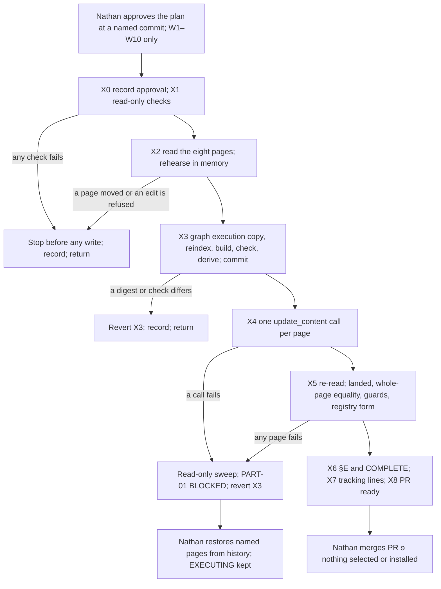

# PLAN successor 2 — the plan for the scope kept in DN-1 — 2026-10-11

**PLAN is complete for the scope Nathan kept in DN-1, and its normal path passes a full dry run.** EXECUTE edits eight unselected candidate pages: 22 bounded operations for F02–F05, checked before and after landing by 9 behavior guards. It also builds a candidate graph execution copy carrying F05 and F09, with its registry inputs. Every step has a command that can fail and an expected value fixed by this dry run. Nothing here is selected, installed or promoted. The plan goes to one bounded FULL review before it returns to Nathan for EXECUTE approval.

This successor does not rewrite the [dated plan](PLAN-20261011.md), [successor 1](PLAN-SUCCESSOR-1-20261011.md) or §A. For the scope kept in DN-1, its steps X0–X8 replace the dated plan's E0–E8: E0 becomes X1; E1 and E3 become X3, graph side only; E2's native-page part becomes X2, X4 and X5; E6 becomes X6's ITEM-03 disposition; E7 becomes X6–X8; and E8's merge stays with Nathan. E2's package part, E4, E5 and E8's install moved with the package work.

## 1. Basis

| Fact | Value |
|---|---|
| Decision | DN-1, Nathan, 2026-10-11: “Option 1. I override the scope freeze for this split, and I accept the re-priced estimate in §6 of PLAN-SUCCESSOR-1-20261011.md.” Recorded as `override: scope_freeze` and in §P, *DN-1 decision* |
| Scope kept | PART-01: the native candidate-page repairs on QA-50, CF-C-30, CF-E-30, IA-30, QA-70, RS-20, ESC-40 and PE (F02–F05), and the candidate execution-copy graph and registry: F05's addendum-contract values, F09's RS-20 → PR-20 edge, the derived registry and the registry guards. PART-03: the completed TypeSafe assessment, with no implementation. PART-04: documentation and the existing Notion tracking |
| Scope moved | The package side of F02, F04 and F05 (change-flow, flowmaster-validate, glow-hde-pr-development), all of F07, PART-02 and F06's candidate contract and profile. They go to a new Modification opened by triage or ANALYZE with `spawned_from` set |
| Repository | `main` `1ea6a262`; branch `docs/20261010-modification-gcfpe-candidate-skill-analysis` (draft PR #600) at `d7e325e0` before this successor |
| Approvals | `analyze_approved_by: Nathan` (2026-10-11); `plan_approved_by` empty |

## 2. What EXECUTE changes, and what it does not

**Native candidate pages.** These are eight unselected GCFPE-20261009.1 candidate siblings. The register still selects GCFPE-20260914.1 / 091426.1. Each page is pinned to the last-edited time this dry run read. A page that has moved since is refused before any write.

| Page | Notion page ID | Pinned last edited | Operations | Findings | Guards | Failing before |
|---|---|---|---|---|---|---|
| QA-50 | `3f44590a05eb815d89d3e602973d83ad` | 2026-10-09T20:13:21.061Z | 1 | F02 | 2 | 2 |
| CF-C-30 | `3f44590a05eb8121af3bf2249c6d6ca8` | 2026-10-09T20:10:50.363Z | 4 | F03, F05 | 5 | 5 |
| CF-E-30 | `3f44590a05eb8104824fe084354a0ef8` | 2026-10-09T20:10:58.798Z | 4 | F03, F05 | 5 | 5 |
| IA-30 | `3f44590a05eb811db88dece791f1f60c` | 2026-10-09T20:11:59.445Z | 4 | F03, F05 | 5 | 4 |
| QA-70 | `3f44590a05eb81209128ea7c82938faf` | 2026-10-09T20:13:24.925Z | 1 | F05 | 3 | 2 |
| RS-20 | `3f44590a05eb81be9566cd6397c9424c` | 2026-10-09T20:13:33.913Z | 1 | F05 | 3 | 2 |
| ESC-40 | `3f44590a05eb8173905cc6d17a40457b` | 2026-10-09T20:11:51.439Z | 2 | F05 | 3 | 2 |
| PE | `3f44590a05eb81f98b76c83465dc1960` | 2026-10-09T20:13:58.466Z | 5 | F04, F05 | 6 | 5 |

The operations are in [edits.json](plan-successor-2/edits.json). Each one names its span by a start anchor and an end anchor on the same line, plus its replacement text. No prompt body is stored. Five guard rows already pass before the repair. G-F05-B passes on IA-30, QA-70, RS-20 and ESC-40, which carry none of the old format homes. G-F03-A passes on PE, which carries no F03 text. These rows stay as regression guards.

**Repository.** Everything EXECUTE adds goes under this Modification's `execute/` directory:

- `execute/candidate-graph-parts/` — a copy of the 2026-10-09 candidate parts (global.json and 55 prompt parts), with F05 and F09 applied by [graph_repair.py](plan-successor-2/graph_repair.py). The shipped `graph_parts.py reindex` keeps the index bookkeeping.
- `execute/candidate-registry-derivation.json` — the shipped `registry_deriver.py --derive` report. It lists the candidate rows whose generator-owned fields differ from the selected registry, with their derived values.
- `execute/candidate-registry-guards.json` — the 9 guards in the registry's own `audit_assertions` form, for the seven member rows. PE has no registry row.

EXECUTE also writes the record's §E and frontmatter.

**Not changed:** selected `docs/graph/parts` and the selected registry; `docs/pfcanon/`; the 2026-10-09 evidence, including its candidate parts and non-derived registry proposal; every skill package and installation; the release register; every candidate page other than the eight above.

## 3. Repair design

Each operation is behavioral; the text is in [edits.json](plan-successor-2/edits.json) and the guards in [guards.json](plan-successor-2/guards.json).

| Finding | Operations | Behavior after repair | Guards |
|---|---|---|---|
| F02 | QA50-1 | QA-50 records the execution arrangement the Product Owner chooses. It requires no executor name, platform or session identity, different operator or DevOps-only venue. Kronos is not categorically barred from execution. Evidence-only commit permission stays explicit and bounded, and fixes use the normal PR route | G-F02-A forbids an executor/operator requirement outside the permitted phrases; G-F02-B requires the new rule once |
| F03 | CFC30-1, CFE30-1, IA30-1, IA30-2, IA30-3 | `DELTA_APPROVE` is nonterminal for the invocation. The producer saves and reads back the decision and the single addendum, then emits exactly one complete continuation block to the receiver recorded by the approved delta's return phase (IA-30: return point). Nathan pastes it; the producer never runs the receiver and adds no paste or presence checkpoint. It returns terminally only when the source, receiver or authority cannot be resolved | G-F03-A forbids a `DELTA_APPROVE` line saying terminal or no continuation unless it is the nonterminal rule; G-F03-B requires the rule once |
| F04 | PE-1 | IA-30 denial in approved-base context returns to IA-40. IA-40 revises a pending preapproval Plan, or authors a separate `MATERIAL_PLAN_DELTA` that returns to the same independent IA-30 reviewer. IA-40 never edits the approved base, reviews its own output or creates the addendum. QA-70's owner stays the originating proposed-delta owner, never QA-80 | G-F04-A forbids the joined “not IA-40 or QA-80” prohibition; G-F04-B requires the IA-40 rule once |
| F05 | CFC30-2/3/4, CFE30-2/3/4, IA30-4, QA70-1, RS20-1, ESC40-1/2, PE-2/3/4/5 | The producer resolves the next continuous number from current controlled PF10 and the format from `PF06-Canon-Change-Process-Guide` §0.1A and `PF27-Canon-Plan-Templates` (*Canon precedence for template use*). It writes one numbered H2 with a descriptive title, H3 or lower children, and page-ready declarative subject matter. Role-addressed instructions stay outside the addendum. It never edits PF10 or claims adoption. Nathan pastes the addendum, and from the next turn it is treated as in force; no agent tracks or asks about the paste | G-F05-A forbids any sentence pairing “allocate” with “number”, except a sentence opening “Outside GCFPE” (the repaired texts say “resolve” and “number”, never “allocate”); G-F05-B forbids the three old format homes; G-F05-C requires the new format text once |
| F05, graph | `global.json` `pf10_addendum_contract` | `producer_allocates_pf10_number: true`. `format_home` names the two canon sources. A new `format_expectations` object states the heading, number carrier, subordinate headings, subject matter and excluded content. Unchanged: `producer_edits_pf10: false`, `producer_claims_canonical_adoption: false`, the six-producer set, `never_for`, `paste_ready: true` and `forbidden_fields`. `pf10_addendum_number` stays forbidden, because the H2 carries the number | [graph_repair.py](plan-successor-2/graph_repair.py) `check` and `built` |
| F09, graph | `prompts/RS-20.json` | A new edge RS-20 → PR-20 with three disjoint branches. `rescope_pr20_preproceed` (APPROVE, exactly one qualifying addendum), `reject_pr20_preproceed` (REJECT) and `in_scope_pr20_preproceed` (IN_SCOPE_REPAIR) each require the actual PR-20 planning author before Proceed. Future Proceed, PR, execution session or vehicle and `PR_RETURN_PHASE` fields stay absent. Each branch is public, nonterminal, `NATIVE_RESULT`, with one handoff. Each heads its group in `state_route_order`. Every existing branch and the three execution-phase values are unchanged | same |

Design points a reviewer should know:

1. **The format list follows canon.** This successor re-read PF06 §0.1A and PF27 on `main`. The dated design's list omitted status, durable requirements, exceptions, nonclaims and consequences, and did not require completed work, future work, recommendations and unproven facts to stay distinct. The shared texts now carry all of them. “Status” is written as the decision's *approval* status, so it cannot be read as the drainage-lifecycle `status` field the contract forbids.
2. **PE's generic Glow clause keeps its non-GCFPE rule, scoped by “Outside GCFPE”.** F05's approved correction scope covers PE's GCFPE authoring rules “including the generic rule where applied to GCFPE”, and preserves other ecosystems' rules. The non-GCFPE remainder still assigns numbering to Nathan, which PF06 §0.1A does not support for agent-authored addenda. It is outside the frozen scope and is listed in §8 as P2-1.
3. **The new edge's position belongs to the shipped builder.** An edge beyond its part's index list is placed after the largest `global.json` index, here 125. `reindex` then renumbers every later edge, so 25 part files change only in `edge_indices`. `graph_repair.py check` proves three things: the bookkeeping is exactly 0..236, every existing edge keeps its relative order, and nothing else in any part moved.
4. **The registry form is weaker than the body guard on one point.** The audit engine's `required_regex` proves presence (at least one unit), and the exactly-once count stays with `body_check.py`. The registry form agrees with every guard on all 24 fixtures and on all 32 page rows before and after (N3).
5. **Landing is checked against the whole page, in memory.** After the write, `body_check.py check` requires the re-read page to equal the pre-edit read of the pinned revision with exactly the planned operations applied. A stray or partial edit, or an interleaved change by someone else, fails it. Nothing is stored or hashed (D22).

## 4. Dry run (D26-A step 1)

Command, committed: [plan-successor-2/dry_run.py](plan-successor-2/dry_run.py). Receipt: [plan-successor-2/dry-run.json](plan-successor-2/dry-run.json), run 2026-10-11T12:02:18Z on this successor's files, before their commit on HEAD `d7e325e0`; `main` `1ea6a262`. The native rows used this session's reads of the eight pages, captured 11:23–11:32Z.

| Gate | Result |
|---|---|
| N0 identities | PASS: glow-graph-contract `9 e241bb9a…` and amthor-workspace-governance-audit `15 c214e874…`, installed and scratch copy, equal to the bindings in successor 1 §2 |
| N1 body guard self-test | PASS: 9 guards, 24 fixture rows; span resolver refuses a second send, an ambiguous start and a cross-line span; landed equality holds for the exact edit and fails on an extra change and on a partial edit |
| N2 native rehearsal | PASS: 8 pages at their pins; 22 of 22 operations applied in memory; every page batch-safe (each old span unique in the unedited page, gone afterwards, with no mention, link or escape markup); 27 failing guard rows before, 0 after; every operation LANDED |
| N3 registry-form guards | PASS: the shipped `_evaluate_assertions` agrees with the guards on 24 of 24 fixtures and 32 of 32 page rows, before and after |
| N4 graph repair self-test | PASS, 17 of 17 cases. A clean repair passes; a second apply is a no-op. Each of these fails for its intended reason: the unrepaired base, a missing reindex, branch removal, a terminal branch, two handoffs, a missing route row, `allocates` false, a stale format home, missing format expectations, `edits_pf10` true, `claims_adoption` true, a changed producer set, a changed `never_for`, dropped forbidden fields and another part moved |
| N5 graph dry run | PASS: apply makes 7 changes, and a second apply makes none. Reindex reports 237 edges and 25 files rewritten; a second reindex rewrites none. Base build: 236 edges, sha256 `3510b2bf…`, as in successor 1 G3. Repaired build: 55 nodes, 237 edges, 596,008 B, sha256 `ff296b1e740a77ee207c1223cc9bdff1f56c6c167bd4714a41ae92ef8708f18b`. `check` and `built` pass |
| N6 registry derivation | PASS: 55 rows, 55 parts, drift exactly `[PR-40, RS-20]`. PR-40's derivation is unchanged from successor 1 G5. RS-20's interfaces and consumers move from `[PR-30, PR-35, RS-30, RS-40]` to `[PR-20, PR-30, PR-35, RS-30, RS-40]`, and its states are unchanged |
| N7 untouched surfaces | PASS: selected parts, selected registry and `docs/pfcanon` equal `main`; the 2026-10-09 candidate parts equal HEAD |
| N8 records and whitespace | PASS: 15 of 15 Modification records validate; `git diff --check` clean |

Expected EXECUTE outputs fixed by this dry run, all deterministic for the pinned inputs:

| Output | Expected |
|---|---|
| Repaired build | 237 edges · 596,008 B · sha256 `ff296b1e740a77ee207c1223cc9bdff1f56c6c167bd4714a41ae92ef8708f18b` |
| `execute/candidate-graph-parts/` (56 files) | `(cd <parts> && find . -type f -name '*.json' \| LC_ALL=C sort \| xargs sha256sum \| sha256sum)` = `b27c11ca2f93fbcb740ebbbd68f54d86bccb5e85703c97d2427a7e59b27e307d` |
| `execute/candidate-registry-derivation.json` | 771 B · sha256 `27a2be82b5336464c83e9c95f9694596d7beddc8c99cda75ed7158560335eb74` · deriver exit 1 (drift) |
| `execute/candidate-registry-guards.json` | 8,869 B · sha256 `8eb546592671932a3051c2c9b5ebb9d1e3f06b94709b9e87c3be4f2dfe8e62ee` |

## 5. EXECUTE steps

Run from the repository root on this Modification's branch, with `PYTHONDONTWRITEBYTECODE=1`. `SK` is the installed skills root, the synced skills bucket with one directory per skill. `SCR` is the session scratch directory. `PLAN_COMMIT` is the commit Nathan approves.

```sh
EX=docs/ephemeral/modifications/evidence/20261010-gcfpe-candidate-skill-analysis
P2=$EX/plan-successor-2
BASE=docs/ephemeral/modifications/evidence/20261009-gcfpe-latest-alpha-analysis/execute/candidate-graph-parts
REG=docs/prompt_ecosystem_management/project-prompt-contract-registry.md
GC=$SK/glow-graph-contract/scripts
AU=$SK/amthor-workspace-governance-audit
PARTS=$EX/execute/candidate-graph-parts
```

| # | Part | Target | Edit | Authority | Verification (each must pass) | Rollback |
|---|---|---|---|---|---|---|
| X0 | all | record frontmatter and §E | Record Nathan's approval verbatim in `plan_approved_by`, with `plan_approved_date`. Set `status: EXECUTING`. Open §E with the approved commit. Commit and push | Template rules 1–2; D21-C | `modification_validate.py` on the record passes its EXECUTE entry gate; `git diff --check` | R-G |
| X1 | all | none (read-only) | Pre-write checks | D26-A; D26-B | `python3 docs/prompt_ecosystem_management/freeze.py "$SK/glow-graph-contract"` prints `9 e241bb9a67c4470895fc666a25d0f97d8df7e8e2df06539de5deaf12bc46467c`; the same for `"$AU"` prints `15 c214e8741e9c54d395cfbd1379cbc7947e6c07beee5bd03aca433dc5dda937ab`; `git diff --quiet $(git merge-base HEAD origin/main) HEAD -- docs/graph/parts "$REG" docs/pfcanon`; `git diff --quiet "$PLAN_COMMIT" HEAD -- "$BASE" "$P2"`; `test ! -e "$EX/execute"`; `python3 "$P2/body_check.py" selftest` and `python3 "$P2/graph_repair.py" selftest "$BASE" "$SCR/selftest" "$GC/graph_parts.py"` each print `"ok": true` | none; stop before any write |
| X2 | PART-01 | the eight pages (read-only) | `notion-fetch` each page by ID, in §2's order; then `python3 "$P2/body_check.py" plan --since-minutes 30` | D22 transient reads | `"ok": true`; every page `revision_matches_plan` and `batch_safe` true; 22 operations applied; every `guards_after` row passes. `ops_payload_for_execute` stays in the session and is never written to the repository | none; stop before any write |
| X3 | PART-01 | `$EX/execute/` | The commands in §5.2, then commit and push | D13 (graph authority); D14 and GUARD-001; dated plan E1/E3 for the graph side | Each expected value in §5.2's comments: the 7 changes, the idempotent second apply and reindex, both builds' edge counts and digests, `check` and `built` `"ok": true`, the deriver's exit 1, and the parts manifest and two file digests equal to §4's. `git status --porcelain` lists only `$EX/execute/` | R-G |
| X4 | PART-01 | Notion writes W1–W8 | One `notion-update-page` call per page, in §2's order. Each call is `{"page_id": <id>, "command": "update_content", "content_updates": <that page's ops_payload_for_execute entries from X2, in order, old_str and new_str verbatim>, "allow_async": false}`. If a call returns an async task, `notion-get-async-task` until it succeeds | Nathan's approval of W1–W8; D27 and the findings | Each call succeeds with no error and no deletion warning | R-N |
| X5 | PART-01 | the eight pages (read-only) | `notion-fetch` each page again; `python3 "$P2/body_check.py" check --since-minutes 240`; `python3 "$P2/body_check.py" registry --audit-root "$AU" --since-minutes 240` | D22 transient reads; D26-E | `check`: every page `revision_moved`, `pre_edit_read_found` and `rest_unchanged` true, `differing_lines` 0, every operation `LANDED`, every guard passing. `registry`: `"ok": true` on the landed pages | R-N for W1–W8; R-G for X3 |
| X6 | all | record §E and frontmatter | Write §E: step dispositions X0–X8, parts, artifacts with their readbacks, interaction cost, remaining PO actions, canon relied on and the D22 disclosure. Item dispositions: ITEM-01 `VERIFIED` (the scope kept by DN-1; the package side moved); ITEM-02 `NOT_APPLICABLE` (PART-02 dropped by DN-1 and moved); ITEM-03 `VERIFIED` (the item is the assessment, which §A.4 and §A.5 hold; implementation, which the dated plan's E6 marked `NOT_APPLICABLE`, is not part of the item and stays absent); ITEM-04 `VERIFIED`. Set `status: COMPLETE` and `interaction_cost_actual`. Commit and push | Template rules 5–6; D26-B | The validator passes at COMPLETE. `git diff --check` is clean. `grep -c 'typesafe-scoring request v6'` on the record prints 1. `git ls-files` lists findings.md, flows.md, source-identities.md, coverage.md, plan-flows.md and this file. After `git fetch origin <branch>`, `git diff --quiet origin/<branch>` holds | R-G |
| X7 | PART-04 | Notion writes W9–W10 | `update_content` on the candidate catalog (W9) and Alpha feedback (W10). Each replaces the single line that begins `**MODIFICATION-20261010 status:**` (written when PLAN returns) with the EXECUTE line in §5.1 | MGMT-10 maintenance surfaces; Nathan's approval of W9–W10 | A re-fetch of each page shows exactly one line with that prefix, carrying the EXECUTE text. The Modification Backlog still shows MB-007 and MB-008 once each | R-T |
| X8 | PART-04 | PR #600 | Update the body under the template headings, including “Merging preserves the record and approves nothing (D21-C)”, and mark it ready for review | AGENTS.md PR-description rule | `pull_request_read` shows the head SHA equal to the pushed SHA, `draft: false` and every template heading | edit the body back |

### 5.1 Notion writes this plan authorizes, and no others

| Write | Page | Content |
|---|---|---|
| W1–W8 | the eight pages in §2 | exactly the 22 operations in edits.json, one `update_content` call per page |
| W9 | candidate catalog `3f44590a05eb8110aa69fe4189ad9abc` | replace the status line with: `**MODIFICATION-20261010 status:** EXECUTE complete on <date>. The eight candidate pages carry the F02–F05 repairs, re-read and checked; the candidate graph execution copy carries F05 and F09 with its registry inputs (<record link at the X6 commit>). The package work moved to a new Modification (DN-1). Nothing is selected or installed; Nathan merges PR #600.` |
| W10 | Alpha feedback `3df4590a05eb8111a6a5f67cb82f96f6` | the same line |

### 5.2 X3 commands

```sh
mkdir -p "$EX/execute"
cp -R "$BASE" "$PARTS"
python3 "$P2/graph_repair.py" apply "$PARTS"           # "changed": 7 entries
python3 "$GC/graph_parts.py" reindex "$PARTS"          # reindex: 237 edges; 25 file(s) rewritten
python3 "$P2/graph_repair.py" apply "$PARTS"           # "already_applied": true
python3 "$GC/graph_parts.py" reindex "$PARTS"          # reindex: 237 edges; 0 file(s) rewritten
python3 "$GC/graph_parts.py" build "$BASE" "$SCR/base.md"       # 236 edges ... sha256 3510b2bf3be6...035506a
python3 "$GC/graph_parts.py" build "$PARTS" "$SCR/repaired.md"  # 237 edges; 596008 bytes; sha256 ff296b1e...8708f18b
python3 "$P2/graph_repair.py" check "$PARTS" "$BASE"                      # "ok": true
python3 "$P2/graph_repair.py" built "$SCR/repaired.md" "$SCR/base.md"     # "ok": true
python3 "$GC/registry_deriver.py" "$AU" "$REG" "$PARTS" --derive \
  > "$EX/execute/candidate-registry-derivation.json"; test $? -eq 1        # drift is the expected result
python3 "$P2/body_check.py" registry --emit > "$EX/execute/candidate-registry-guards.json"
sha256sum "$EX/execute/candidate-registry-derivation.json" "$EX/execute/candidate-registry-guards.json"
(cd "$PARTS" && find . -type f -name '*.json' | LC_ALL=C sort | xargs sha256sum | sha256sum)
git status --porcelain
```

## 6. Failure path (D26-B) and rollbacks

A failed verification stops EXECUTE at that step. Nothing is retried or worked around. In every case `status` stays `EXECUTING`, the freeze is kept, and Nathan decides the next step: a dated successor plan, a restore, or abandonment.

- **Before X4**, no external write has happened. If X3 committed, revert it under R-G. Record the failure in §E, with the failed step `BLOCKED` and later steps `NOT_RUN` citing the stop. Commit and push, and return to Nathan.
- **From X4 onward**, use the D26-B carve-out:
  - Run a read-only sweep: re-fetch every page and run `body_check.py check`. It reports, by counts, which operations are `LANDED`, `UNTOUCHED` or `CONFLICT`.
  - Record PART-01 as `BLOCKED`, naming the pages written. Revert X3 under R-G.
  - Keep `status: EXECUTING` and the freeze.
  - Commit the failure record to the branch, whose PR is the record PR, and return to Nathan with DECISION NEEDED.

Rollbacks:

- **R-G (repository):** `git revert --no-edit <commit>`, then push. This never rewrites history.
- **R-N (native page):** Nathan restores the page from Notion page history to the revision pinned in §2. A copy of the old body that would allow an automated reversal is forbidden by D22, which is why this is the template's rule-6 carve-out. After a restore, a read shows every operation `UNTOUCHED`. The page's last-edited time necessarily moves, so a resumed EXECUTE needs a dated successor plan that re-pins it (D26-C).
- **R-T (tracking line):** `update_content` that swaps the new line back for the old. Both texts are this Modification's own, not prompt bodies.

## 7. Flow

This diagram replaces the first diagram in [plan-flows.md](plan-flows.md) for the scope kept in DN-1. The second and third diagrams there still describe the repaired behavior: the standalone delta with its qualifying continuation (F03, F04, F05) and RS-20's return by lifecycle stage (F09).



## 8. Open findings, accepted as risks

Approving the plan accepts these (DISP-001). None is a required kind under D26-A rule 8 within this Modification's scope. The moved findings stay required in the package Modification.

| ID | Path | Likelihood | Consequence | Why listed, not repaired |
|---|---|---|---|---|
| F01 | change-flow, PR-development, validator profile: role/artifact continuity versus persistent-session prerequisites | medium in qualification | a compatibility stop, loud | listed by ANALYZE and not opted in (§A.10) |
| F06 | flowmaster-validate, change-flow contract and profile | certain once packages are rebuilt | stale candidate checks | moved with the package work (DN-1) |
| F07 | change-flow and validator advice prohibition | as ANALYZE found | human advice suppressed in packages | moved: package-only |
| F08 | change-flow and validator remediation verdict versus native ESC | medium in qualification | a compatibility stop | listed by ANALYZE and not opted in |
| L01–L11 | as in [findings.md](findings.md), *Listed observations and boundaries* | as listed there | as listed there | listed observations, unchanged |
| L-A1, L-A2 | ANALYZE review: F04's change-flow quotation context; the QA-120 diagram arrow | medium and low | clarification work; a diagram misread | carried unchanged by the ANALYZE DIFF_CHECK; L-A1 concerns the moved package side |
| MB-005 | two glow-merged-change-attribution-lock trees advertise 1.2.0 | certain in package gates | package validation cannot use the analysed bytes | out of scope; on the Modification Backlog; affects only the moved package work |
| MB-006 | the review brief does not ask for *Canon relied on*; the hook reports two dated ANALYZE reviews | certain | an advisory hook message after each shell command | out of scope; on the backlog; dated records stay as written |
| SB-1 | session-branch-flowmaster has no repository verdict | certain in package gates | package suite pins only | affects only the moved package work |
| P2-1 | PE's generic Glow clause outside GCFPE still assigns numbering to Nathan, against PF06 §0.1A for agent-authored addenda | applies only outside GCFPE | another ecosystem's producer is taught the old division | outside the frozen scope (F05 covers GCFPE); recorded on the Modification Backlog as MB-007, S3, on 2026-10-11 |
| P2-2 | existing RS-20 graph branches cite section “Required result and routing”; the live candidate heading is “Result routing” | certain | an evidence label points at a renamed heading; routing unaffected | label only; the new branches cite the live headings |
| P2-3 | registry-form required guards prove presence, not exactly-once | low | a duplicated repair line passes the registry form | `body_check.py` keeps the exact count; the registry form agrees on every fixture and page row |
| P2-4 | until the package Modification regenerates the contract, the September validator rejects the repaired candidate graph's F05 values | certain if run against the candidate | a validator failure on an unselected candidate | the candidate is unselected and no gate here runs that validator against it; the package work owns the contract |
| P2-5 | Notion renders a landed text differently from the text written | low: the new texts use constructs already on these pages | a false stop at X5 after writes, so Nathan restores pages | detected, never silent; cannot be dry-run without a write |
| P2-6 | no fresh sweep of the other 47 candidate pages for surviving old rules | low: ANALYZE screened all 55 members at these revisions | an unlisted page keeps an old rule | an all-page read costs about 0.5M tokens; release qualification runs the registry assertions across every row |

## 9. Product Owner actions

| Action | How it is verified |
|---|---|
| Approve the plan. A form that fits this record: “Nathan approves the plan of MODIFICATION-20261010-gcfpe-candidate-skill-analysis at `<commit>`, accepting the open findings in PLAN successor 2 §8. It authorizes the Notion writes W1 to W10 and no others. Go on to EXECUTE.” | X0's validator entry gate |
| Merge PR #600 after EXECUTE | the PR shows merged; `main` holds the record at `COMPLETE` |
| On the failure path only: restore the named pages from Notion page history | a read shows every operation `UNTOUCHED` |
| When he chooses: open the new Modification for the moved package work, by triage or ANALYZE. MB-008 (S2), recorded on the Modification Backlog on 2026-10-11, carries it until then | the new record validates with `spawned_from: MODIFICATION-20261010-gcfpe-candidate-skill-analysis` |

There is no install, promotion, release selection or skill review in this Modification.

## 10. Explicitly not in scope

- The package side of F02, F04 and F05; F06; F07; PART-02 (moved by DN-1).
- Selected graph parts, the selected registry, release selection, promotion and installation.
- Assembling an installable candidate registry. It needs the final candidate, so it belongs to release qualification, which takes the derivation and guard files above as inputs.
- PE's rules outside GCFPE (P2-1).
- F01, F08 and L01–L11.
- Any PF canon change.

## 11. Review, cost and estimate

**Review.** One FULL round of two fresh-context reviewers follows this commit, from a brief committed before they are spawned. At most one DIFF_CHECK follows a repair. Only the four required kinds are repaired. The round stops early on non-convergence or at twice the re-priced estimate. Every round goes in the `reviews` ledger. Neither FULL review nor the DIFF_CHECK has been used for PLAN.

**Spend against the re-priced estimate** (2–4 h and 1.1–1.7M aggregate tokens from the decision). Time: the decision was recorded at 11:20Z, and this successor was committed about 45 minutes later. Tokens are not measured as an aggregate. The session budget counter fell by about 0.2M after the context reset at about 11:23Z. That counter has reset before when the worker restarted, so it is not an aggregate. The part between the decision and the reset is unmeasured. The interaction forecast stays at successor 1's figure of about 8, against ANALYZE's recorded 11. Remaining interactions: EXECUTE approval and the merge, plus one if EXECUTE stops after a write.

## 12. Transient reads (D22)

Page bodies were read only as transient reads. They are this session's own fetch results, kept in its harness records, and were read by `body_check.py` for the read in hand. Nothing in the repository holds a body, a body hash or a body comparison. The anchors in edits.json are short phrases, of the kind the findings quote. The harness files holding fetched bodies cannot be deleted from this session (`rm` is refused as transcript tampering), so they are left to harness teardown:

- PE: tool results `…1791704373809.txt` and `…1791717822802.txt`
- release register: `…1791704456929.txt`
- Alpha feedback: `…1791704550479.txt`, `…1791707266261.txt` and `…1791709022479.txt`
- QA-50, CF-C-30, CF-E-30, IA-30, QA-70, RS-20 and ESC-40: inline in the session transcript

## 13. Canon relied on

| Source | Sections read | Use |
|---|---|---|
| PF06-Canon-Change-Process-Guide v2.5.4, `main` | §0.1A, including its agent-authored addendum rule (line 64) | F05's numbering and format; P2-1 |
| PF27-Canon-Plan-Templates v2.0.5, `main` | *Canon precedence for template use* (lines 280–294) | F05's format; canon resolution and storage under `docs/ephemeral/` |
| PF10-HDE-Build-Notes v13.5.1, `main` | read in full earlier in this session (successor 1 §8); lines 19–33 re-read here | No current addenda; nothing overrides PF06 or PF27 on addendum format |
| PF04-Canon-HDE-Governance v2.8.7, `main` | §9.1.2, §9.1.3 and §9.1.6, read earlier in this session | Canon-first recording; one coherent successor selection (why the packages moved) |
| In-flight: this Modification | §A (approved), §A.10, dated §P, successor 1, the DN-1 decision, findings.md, plan-redlines.md, plan-flows.md, coverage.md, REVIEW-ANALYZE-DIFF.md, plan-publication.json | Scope, redlines, listed findings |
| In-flight: MODIFICATION-20261009 | `execute/README.md`, `execute/candidate-registry-nonderived.json` and `execute/candidate-graph-parts/` | The base candidate and its non-derived registry boundary |
| Repository controls | modification-template.md (rules 1–8, §P and §E); modification_validate.py; decision record D13, D14, D21-C, D22, D26 and D27; AGENTS.md | Process rules applied |
| Shipped tools | glow-graph-contract `graph_parts.py` and `registry_deriver.py`; amthor-workspace-governance-audit `_evaluate_assertions` | Interfaces the commands rely on |

Merging preserves the record and approves nothing (D21-C).
