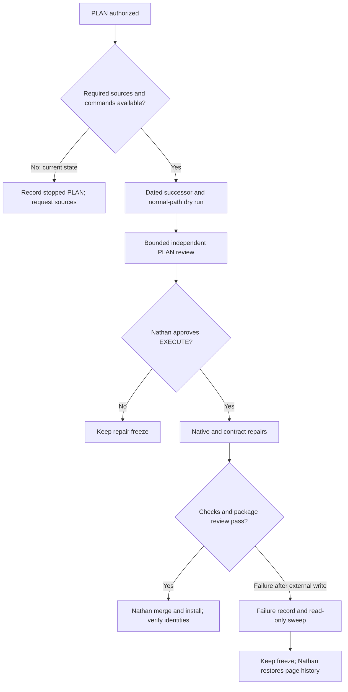
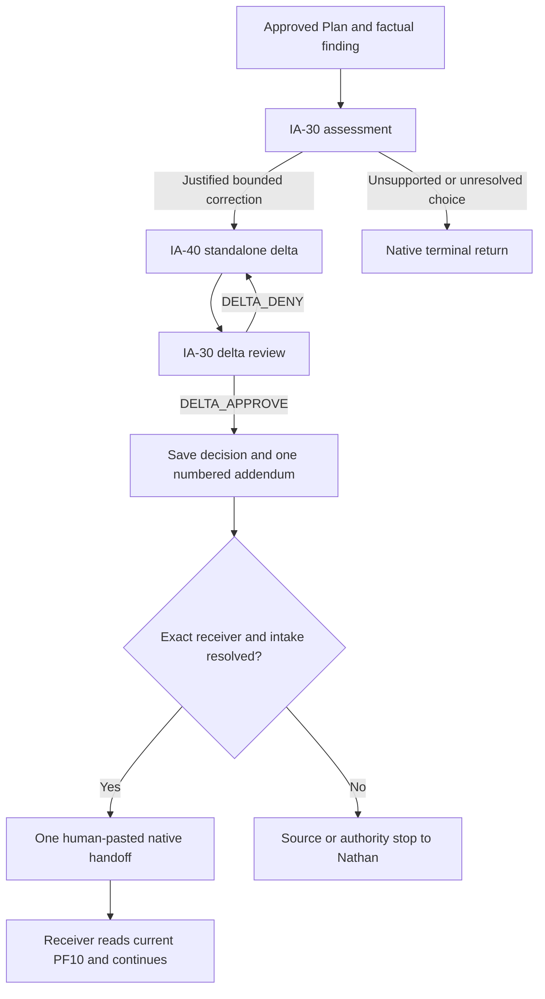
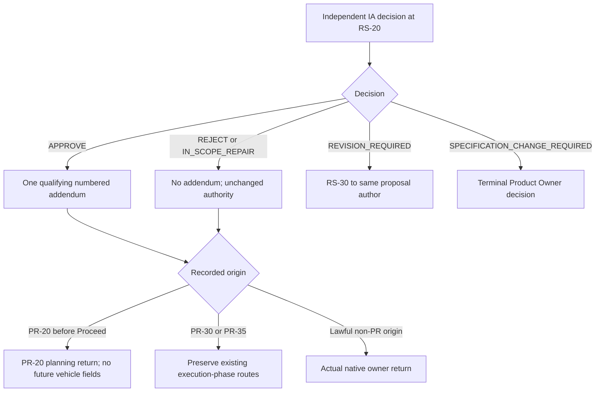

# Planned repair flows — 2026-10-11

These diagrams describe the proposed repairs and their remaining gates. They do not claim execution or replace the approved graph. The original analysis diagrams remain historical evidence.

## Repair and review boundary

All three packages share one delivery cycle across PART-01/02. Success here does not promote the candidate; full qualification still has F01/F06/F08 and source dependencies.

## Standalone Plan delta and qualifying continuation

The approved Plan remains unchanged throughout. CF-C-30/CF-E-30 qualifying approvals use the same final continuation rule, with their own native Specification review. The producer never runs the receiver or verifies Nathan's PF10 paste. QA-80 is not inferred to share IA-40's delta-authoring mode.

## RS-20 return by actual lifecycle stage

For APPROVE, proceeded PR-30 prepublication returns directly to PR-30; actual open-PR PR-30/PR-35 phases use RS-40. REJECT/IN_SCOPE_REPAIR preserve their direct existing-owner routes. The three execution-phase enum values stay unchanged. This diagram does not invent a PR owner for a non-PR finding.
